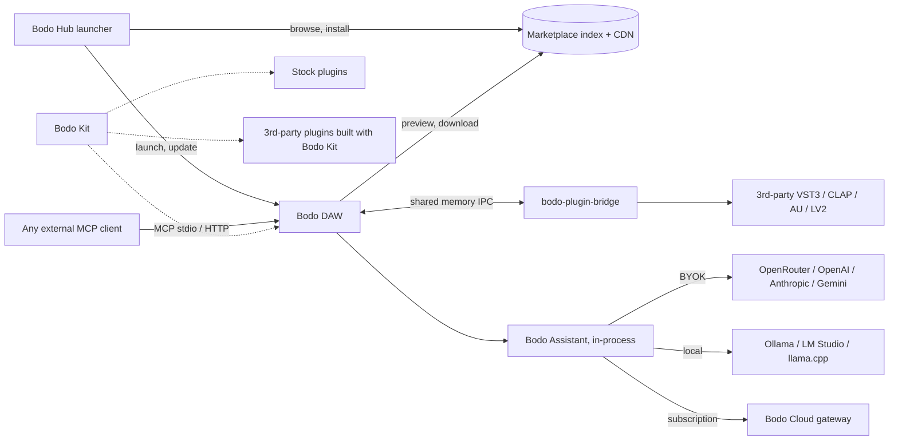
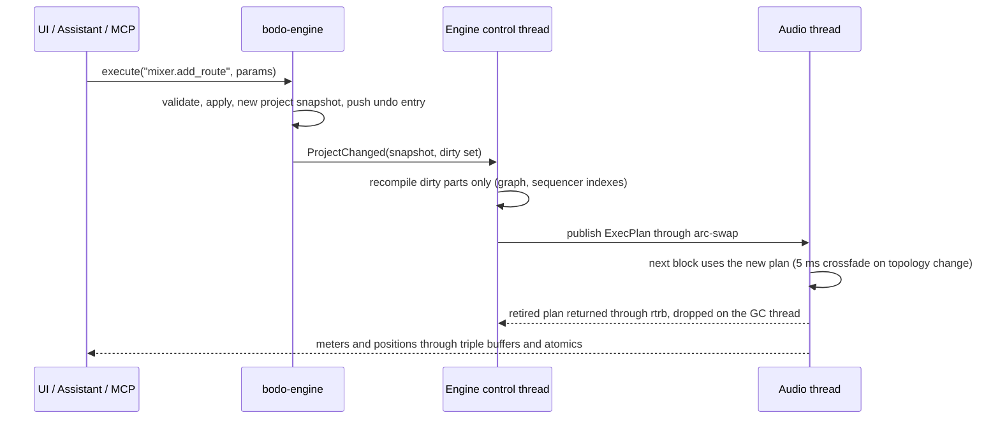

# Bodo

> A free, open-source, AI-native digital audio workstation written entirely in Rust.

| | |
|---|---|
| Document | Master specification (living document) |
| Version | 0.1, 2026-10-13 |
| Owner | hasan-muzak |
| DAW license | GPL-3.0-or-later |
| Bodo Kit license | MIT OR Apache-2.0 |
| Platforms | macOS (Apple Silicon), Windows 10/11, Linux |

---

## Table of contents

1. [Vision and principles](#1-vision-and-principles)
2. [Product map](#2-product-map)
3. [Technology stack](#3-technology-stack)
4. [Repository layout and layering](#4-repository-layout-and-layering)
5. [Bodo Kit: the audio framework](#5-bodo-kit-the-audio-framework)
6. [Audio engine](#6-audio-engine)
7. [Plugin hosting](#7-plugin-hosting)
8. [Domain model](#8-domain-model)
9. [Mixer](#9-mixer)
10. [Channel Rack, Playlist and Piano Roll](#10-channel-rack-playlist-and-piano-roll)
11. [Stock plugins](#11-stock-plugins)
12. [Command system and MCP](#12-command-system-and-mcp)
13. [Bodo Assistant](#13-bodo-assistant)
14. [GUI and design system](#14-gui-and-design-system)
15. [Marketplace](#15-marketplace)
16. [Bodo Hub (launcher)](#16-bodo-hub-launcher)
17. [Bodo Cloud](#17-bodo-cloud)
18. [Project format and interchange](#18-project-format-and-interchange)
19. [Engineering standards](#19-engineering-standards)
20. [Roadmap](#20-roadmap)
21. [Risks and open questions](#21-risks-and-open-questions)
22. [Appendix: references](#22-appendix-references)

---

## 1. Vision and principles

Bodo is a complete music production environment. You can compose, arrange, record, mix, master and export in it. Its workflow is pattern based and will feel familiar to FL Studio users, and it ships with an AI assistant that can do real production work: it writes parts the way a pianist would play them, mixes and masters stems, and designs sounds in a synthesizer. Everything is free. The one paid product is **Bodo Cloud**, which gives you managed access to AI models so you don't have to bring your own API key.

### 1.1 Principles

1. **Free forever.** The DAW, Bodo Kit, the stock plugins, the marketplace and its content, and MCP access are all free. Users run the assistant with their own key (OpenRouter, OpenAI, Anthropic, Gemini) or a local model at no cost. Bodo Cloud sells convenience. It does not unlock features.
2. **AI-native, AI-optional.** Every feature works without AI, and the AI can reach every feature. Both go through the same command system (see [section 12](#12-command-system-and-mcp)).
3. **Real-time correctness first.** The audio thread never allocates, takes a lock or blocks. A dropout is a bug.
4. **One mutation path.** The UI, shortcuts, the command palette, scripts, MCP clients and the assistant all change the project through `engine.execute(command_id, params)`.
5. **Native and fast.** 100% Rust. No Electron, no web views. A GPU-rendered UI at 120 fps where the display supports it.
6. **Clean, predictable code.** Crates are layered. Every non-O(1) function documents its complexity. There are no hidden quadratic algorithms (see [section 19](#19-engineering-standards)).
7. **Clean room.** FL Studio inspires the workflow and layout. We learn from FL's public online manual and from behavior we observe as users. We never decompile, disassemble or extract anything from a commercial product, and we never copy its names, skins, icons or graphics.
8. **Open formats.** `.bodo` projects are documented JSON. DAWproject, Standard MIDI Files, WAV and FLAC can be imported and exported.
9. **Privacy by default.** Nothing leaves the machine unless the user picks a cloud model or a marketplace action. Telemetry is off by default.

### 1.2 Goals for 1.0

- The full production workflow: channel rack, patterns, playlist, piano roll, automation, audio recording, mixer, mastering, stem export.
- VST3, CLAP and AU (macOS) hosting, plus LV2 on Linux, with optional crash isolation.
- A professional set of stock instruments and effects, all built with Bodo Kit.
- The Bodo Assistant, plus an MCP server that any agent can drive.
- A free marketplace for samples, presets, templates and open-source plugins, with instant previews.
- The Bodo Hub launcher and auto-updates.

### 1.3 Non-goals for 1.0

- VST2. Steinberg no longer grants licenses, so it can't be supported legally.
- AAX, video editing, a score or notation editor, real-time collaborative editing, mobile.
- Importing proprietary projects (FLP, ALS). These may come later as community tools based on publicly documented formats.

---

## 2. Product map

| Component | Location | License | Purpose |
|---|---|---|---|
| Bodo DAW | `apps/bodo`, `crates/*` | GPL-3.0-or-later | The application |
| Bodo Kit | `kit/*` | MIT OR Apache-2.0 | JUCE-like framework for plugins and audio apps. Bodo itself is built on it |
| Stock plugins | `plugins/*` | GPL-3.0-or-later | Built-in instruments and effects. Each can also be exported as CLAP, VST3, AU or a standalone app |
| Bodo Hub | `apps/bodo-hub` | GPL-3.0-or-later | Launcher, updater, project dashboard, marketplace front, account |
| bodo-cli | `apps/bodo-cli` | GPL-3.0-or-later | Headless rendering, MCP over stdio, project tools, marketplace publishing |
| bodo-plugin-bridge | `apps/bodo-plugin-bridge` | GPL-3.0-or-later | Sandboxed plugin host process and plugin scanner |
| Marketplace | `services/market` (separate repo later) | AGPL-3.0 (proposed) | Package index, review pipeline, CDN delivery |
| Bodo Cloud | `services/cloud` (separate repo later) | Open question ([section 21](#21-risks-and-open-questions)) | Model gateway for subscribers: auth, metering, billing |



### 2.1 Business model

| Free | Paid (Bodo Cloud subscription) |
|---|---|
| The DAW, every feature, every stock plugin | A managed model key with monthly credits |
| The assistant with any user-supplied key, or with local models | No API key setup and curated model routing |
| The MCP server for any external agent | Usage dashboard and spend caps across devices |
| The marketplace and all of its content | |
| Bodo Kit for building your own plugins, including commercial ones | |

The agent always runs locally inside Bodo. Bodo Cloud is only a model gateway that speaks the OpenAI-compatible protocol, so BYOK users and subscribers get exactly the same assistant features. This is honest, and it fits the GPL: there is no closed-source feature to strip out of a fork.

---

## 3. Technology stack

All versions were checked against crates.io and GitHub on 2026-10-13. The workspace `Cargo.toml` names full versions, the committed `Cargo.lock` pins the exact versions every build uses (ADR 0011), and a bot opens weekly update PRs.

| Area | Crate / tool | Version | License | Use |
|---|---|---|---|---|
| Language | Rust stable, edition 2024 | pinned in `rust-toolchain.toml` | MIT/Apache | Everything |
| GUI | `egui`, `eframe`, `egui-wgpu` | 0.36.2 | MIT/Apache | Immediate-mode UI (same stack as pixel3d) |
| GUI | `wgpu` | 30.0.1 | MIT/Apache | GPU backend (Metal, DX12, Vulkan), custom render passes |
| GUI | `craft-ui` (storytold/craft-libs) | git rev pinned | MIT/Apache | Shared tokens, docking, base widgets |
| GUI | `baseview` | 0.4.1 | MIT/Apache | Plugin editor windows inside hosts |
| GUI | `muda`, `rfd`, `arboard` | 0.21 / 0.17 / 3.6 | MIT/Apache | Native menu (macOS), file dialogs, clipboard |
| GUI tests | `egui_kittest` | 0.36.2 | MIT/Apache | UI snapshot tests |
| Audio I/O | `cpal` (+ `asio` feature) | 0.18.2 | Apache-2.0 | CoreAudio, WASAPI, ASIO, ALSA, PipeWire, JACK |
| Audio I/O | `rtaudio` | 0.8.1 | MIT | Fallback for duplex on backends cpal lacks |
| Audio I/O | `wasapi` | 0.26.0 | MIT | WASAPI exclusive mode (later) |
| MIDI | `midir` | 0.11.1 | MIT | MIDI device I/O |
| MIDI | `midly` | 0.5.3 | Unlicense | Standard MIDI File read and write |
| MIDI | `midi2` | 0.11.1 | MIT/Apache | MIDI 2.0 / UMP |
| Real-time | `rtrb` | 0.4.0 | MIT/Apache | Wait-free SPSC queues |
| Real-time | `basedrop` | 0.1.3 | MIT/Apache | Deferred deallocation off the audio thread |
| Real-time | `arc-swap` | 1.9.2 | MIT/Apache | Lock-free plan and snapshot swaps |
| Real-time | `triple_buffer` | 9.0.0 | MPL-2.0 | Meters and visualizer data |
| Real-time | `atomic_float`, `no_denormals` | 1.1.0 / 0.3.0 | MIT/Apache, MIT | Atomic params, flush-to-zero |
| Real-time | `audio_thread_priority` | 0.38 | MPL-2.0 | RT promotion of worker threads |
| Real-time QA | `assert_no_alloc`, `rtsan-standalone` | 1.1.2 / 0.3.0 | BSD-1, Apache-2.0 | Catch allocations, locks and syscalls on RT threads |
| DSP | `rubato` | 5.0.1 | MIT/Apache | Sample rate conversion |
| DSP | `realfft`, `rustfft` | 3.5 / 6.4.1 | MIT/Apache | FFT, convolution, analysis |
| DSP | `signalsmith-stretch` | 0.1.3 | MIT | Time stretching and pitch shifting |
| DSP | `audioadapter` | 5.0.0 | MIT/Apache | Buffer layout adapters |
| Files | `symphonia` | 0.6.1 | MPL-2.0 | Decoding (WAV, FLAC, MP3, AAC, OGG, ALAC) |
| Files | `hound` | 3.5.1 | Apache-2.0 | WAV writing |
| Files | `creek` | 1.2.3 | MIT/Apache | Real-time disk streaming |
| Hosting | `clack-host`, `clack-extensions` | 0.2.0 | MIT/Apache | CLAP hosting |
| Hosting | `vst3` (coupler-rs) | 0.3.0 | MIT/Apache | VST3 COM bindings (the SDK has been MIT since 2025-10-29) |
| Hosting | `objc2-audio-toolbox`, `objc2-avf-audio` | 0.3.2 | Zlib/MIT/Apache | AUv2 and AUv3 hosting and export |
| Hosting | `livi` | 0.7.5 | MIT | LV2 hosting (Linux) |
| Hosting | `libloading` | 0.8 | ISC | Loading dynamic libraries |
| Authoring | `clack-plugin` | 0.2.0 | MIT/Apache | CLAP ABI used by the Bodo Kit CLAP exporter |
| Data | `serde`, `serde_json` (`float_roundtrip`) | 1 | MIT/Apache | Project files, command params |
| Data | `schemars` | latest | MIT | JSON Schema for every command |
| Data | `imbl` | 7.0 | MPL-2.0 | Persistent collections for structural sharing |
| Data | `ulid`, `zip`, `zstd`, `tar`, `blake3`, `toml` | latest | MIT/Apache family | IDs, containers, hashing, manifests |
| Errors and logs | `thiserror`, `anyhow`, `tracing` | 2 / 1 / 0.1 | MIT/Apache | `thiserror` in libraries, `anyhow` in apps |
| AI | `rmcp` | 3.5.1 | Apache-2.0 | Official MCP SDK (stdio and streamable HTTP) |
| AI | `genai` | 0.6.5 | MIT/Apache | Multi-provider LLM adapters behind our own trait |
| AI | `tokio`, `reqwest`, `keyring` | latest | MIT/Apache | Async runtime (top layer only), HTTP, OS keychain |
| Distribution | `velopack` | 1.2 | MIT | Installers and delta updates |
| Distribution | `minisign`, `ed25519-dalek` | 0.10 / 3.0 | MIT, BSD-3 | Signing marketplace packages and release artifacts |
| Services | `axum`, `sqlx` (Postgres), S3-compatible storage (Cloudflare R2), Stripe | latest | MIT/Apache | Marketplace API and Cloud gateway |
| Testing | `proptest`, `insta`, `criterion`, `cargo-fuzz`, clap-validator, pluginval, auval | latest | various | See [section 19](#19-engineering-standards) |

### 3.1 Licensing notes

- **VST3:** Steinberg relicensed the VST 3 SDK under MIT on 2025-10-29, so both the GPL DAW and the MIT/Apache Kit can host and export VST3. Before using any VST logo or trademark, check Steinberg's current trademark terms.
- **VST2:** not supported. No license is available, and open-source hosts that used reverse-engineered headers have received takedown notices.
- **ASIO:** since October 2025 the ASIO SDK is dual licensed, GPLv3 or proprietary. Bodo Kit's `asio` feature is off by default. Windows builds of Bodo, which is GPL-3, enable it. Third parties who enable it in their own Bodo Kit products must comply with GPLv3 or get Steinberg's proprietary license.
- **MPL-2.0** dependencies (`symphonia`, `imbl`, `triple_buffer`, `audio_thread_priority`) are copyleft at the file level only, and are compatible with both the MIT/Apache Kit and the GPL DAW.
- **`cargo-deny` policy:** Kit crates may depend only on permissive or MPL-2.0 licenses. DAW crates may also use GPL-compatible licenses. CI fails on any violation.

---

## 4. Repository layout and layering

The project is a monorepo with one Cargo workspace. Each crate sets its own license in `Cargo.toml`.

```
bodo/
├── Cargo.toml                 # workspace: members, shared dependency versions, lints
├── rust-toolchain.toml
├── deny.toml                  # license and advisory policy (Kit vs DAW)
├── rustfmt.toml, clippy.toml
├── kit/                       # Bodo Kit, MIT OR Apache-2.0
│   ├── bodo-kit-core/
│   ├── bodo-kit-midi/
│   ├── bodo-kit-dsp/
│   ├── bodo-kit-audio/
│   ├── bodo-kit-analysis/
│   ├── bodo-kit-music/
│   ├── bodo-kit-graph/
│   ├── bodo-kit-plugin/
│   ├── bodo-kit-host/
│   ├── bodo-kit-device/
│   ├── bodo-kit-ui/
│   ├── bodo-kit-plugin-clap/
│   ├── bodo-kit-plugin-vst3/
│   ├── bodo-kit-plugin-au/
│   ├── bodo-kit-plugin-standalone/
│   └── examples/              # gain, sine synth, EQ: minimal reference plugins
├── crates/                    # Bodo DAW, GPL-3.0-or-later
│   ├── bodo-model/
│   ├── bodo-io/
│   ├── bodo-mix/
│   ├── bodo-engine/
│   ├── bodo-llm/
│   ├── bodo-mcp/
│   ├── bodo-agent/
│   ├── bodo-control/
│   ├── bodo-market/
│   └── bodo-ui/
├── plugins/                   # stock instruments and effects, GPL-3.0-or-later
├── apps/
│   ├── bodo/                  # the DAW
│   ├── bodo-hub/              # launcher
│   ├── bodo-cli/              # headless: render, mcp, market publish, project tools
│   └── bodo-plugin-bridge/    # sandboxed plugin host and scanner
├── xtask/                     # cargo xtask ci | layers | deny | kit new | bundle
├── assets/                    # icon subset (Tabler), fonts, factory content
└── docs/
    ├── adr/                   # architecture decision records
    ├── agents/                # guides for agents using MCP
    ├── formats/               # .bodo and .bodopack specifications
    └── STATUS.md              # progress per milestone
```

### 4.1 Layers

| Layer | Crates | Responsibility |
|---|---|---|
| L0 | `bodo-kit-core`, `bodo-kit-midi` | Time units, RT primitives, RT thread pool, MIDI 1/2, SMF, MPE |
| L1 | `bodo-kit-dsp`, `bodo-kit-audio` | DSP building blocks; audio files, peaks, streaming |
| L2 | `bodo-kit-analysis`, `bodo-kit-music`, `bodo-kit-graph` | Measurement, music theory and performance, the audio graph |
| L3 | `bodo-kit-plugin`, `bodo-kit-host`, `bodo-kit-device`, `bodo-kit-ui` | Plugin API, hosting, devices, widgets |
| L4 | `bodo-kit-plugin-clap`, `-vst3`, `-au`, `-standalone` | Exporters that turn a Bodo Kit plugin into each format |
| L5 | `bodo-model` | The project document, its invariants and snapshots |
| L6 | `bodo-io`, `bodo-mix` | File formats and interchange; realtime and offline render engine |
| L7 | `bodo-engine` | Command registry, transactions, undo, branches |
| L8 | `bodo-llm`, `bodo-mcp`, `bodo-agent`, `bodo-control`, `bodo-market`, `bodo-ui` | Async services, AI and the interface |
| apps | `bodo`, `bodo-hub`, `bodo-cli`, `bodo-plugin-bridge` | Binaries |
| plugins | stock plugins | Depend on Kit (L0 to L4) only |

Rules, enforced by `cargo xtask layers` in CI:

- A crate depends only on crates in **strictly lower** layers. Any exception must be listed in `docs/architecture.md`.
- **Kit never depends on DAW crates.** This keeps the license boundary clean and Kit reusable on its own.
- **Async lives only at the top:** `tokio`, `reqwest` and `rmcp` are allowed only in L8 and in apps. L0 to L7 are synchronous.
- **`egui` is allowed only in** `bodo-kit-ui`, `bodo-ui` and the apps.
- **`unsafe` is forbidden** across the workspace. Crates that need FFI (`bodo-kit-core` for OS thread APIs, `bodo-kit-host`, `bodo-kit-device`, the plugin exporters and `bodo-plugin-bridge`) keep every `unsafe` block inside an `ffi.rs` file or an `ffi/` module. Each block carries a `// SAFETY:` comment.
- **Stock plugins use the public Bodo Kit API only.** This proves the framework works, and it means any stock plugin can ship standalone.

---

## 5. Bodo Kit: the audio framework

The goal is that you can write a professional plugin or audio app in Rust in an afternoon. Bodo itself is built on the same crates, so the framework is tested every day by a full DAW.

| Crate | Provides | JUCE analogue |
|---|---|---|
| `bodo-kit-core` | `Tick`/`Frames`/`Seconds` units, tempo math, SPSC queues, GC handles, atomic params, triple buffers, RT thread pool joined to the OS audio workgroup, debug guards for RT safety, denormal guards | `juce_core` (part of it) |
| `bodo-kit-midi` | MIDI 1.0 and MIDI 2.0 UMP events, SMF read/write, MPE allocator, note expressions | MIDI parts of `juce_audio_basics` |
| `bodo-kit-dsp` | Biquad and SVF filters, PolyBLEP and mip-mapped wavetable oscillators, envelopes, LFOs, delay lines, polyphase oversampling, FFT and partitioned convolution, resampling, parameter smoothing, gain and pan laws, stretch and pitch wrappers | `juce_dsp` |
| `bodo-kit-audio` | Audio file read/write, peaks pyramid, disk streaming, sample cache | `juce_audio_formats` |
| `bodo-kit-analysis` | BS.1770-4 loudness, true peak, spectrum, stereo, masking, onsets, key/tempo/chord detection | (none) |
| `bodo-kit-music` | Scales, chords, voicing, voice leading, humanization, groove templates | (none) |
| `bodo-kit-graph` | Generic processing graph: incremental cycle checks, scheduling, latency compensation, buffer reuse, parallel executor | `AudioProcessorGraph` |
| `bodo-kit-plugin` | Plugin authoring API: parameters, state, buses, events, editors | `AudioProcessor` |
| `bodo-kit-plugin-*` | CLAP, VST3, AU and standalone exporters, all pure Rust | `juce_audio_plugin_client` |
| `bodo-kit-host` | Hosting CLAP, VST3, AU and LV2 behind one trait; scanner; sandbox IPC protocol | Hosting parts of `juce_audio_processors` |
| `bodo-kit-device` | Audio and MIDI devices, clock, latency reporting | `juce_audio_devices` |
| `bodo-kit-ui` | Knob, fader, meter, waveform, spectrum, XY pad, envelope editor, on-screen keyboard, preset browser; plugin windows through baseview | `juce_gui_basics` |

### 5.1 Plugin API sketch

```rust
use bodo_kit_plugin::prelude::*;

#[derive(Params)]
pub struct CompParams {
    #[param(id = 1, name = "Threshold", range = -60.0..=0.0, unit = "dB", default = -18.0,
            smooth = Linear(ms(20.0)), tags = ["dynamics", "threshold"])]
    pub threshold: FloatParam,
    #[param(id = 2, name = "Ratio", range = 1.0..=20.0, taper = Log, default = 4.0)]
    pub ratio: FloatParam,
    #[param(id = 3, name = "Mode")]
    pub mode: EnumParam<CompMode>,
}

pub struct Comp {
    params: Arc<CompParams>,
    detector: EnvelopeFollower,
}

impl Plugin for Comp {
    type Params = CompParams;

    const INFO: PluginInfo = PluginInfo {
        id: "dev.bodo.comp",
        name: "Bodo Comp",
        vendor: "Bodo",
        kind: PluginKind::Effect,
        version: env!("CARGO_PKG_VERSION"),
    };
    const LAYOUTS: &'static [BusLayout] = &[BusLayout::stereo().with_stereo_sidechain()];

    fn new(params: Arc<CompParams>) -> Self { /* ... */ }

    /// Called off the audio thread. Allocate everything here.
    fn activate(&mut self, cfg: &ProcessConfig) -> Result<(), ActivateError> { /* ... */ }

    fn reset(&mut self) { /* clear state, no allocation */ }

    /// Audio thread. Must not allocate, lock or block.
    fn process(&mut self, ctx: &mut ProcessContext<'_>) -> ProcessStatus {
        for chunk in ctx.split_at_events() {
            // events carry sample offsets; parameters are already smoothed per chunk
        }
        ProcessStatus::Normal
    }

    fn latency(&self) -> u32 { 0 }
    fn tail(&self) -> Tail { Tail::None }
    fn editor(&mut self) -> Option<Box<dyn Editor>> {
        Some(Box::new(CompEditor::new(Arc::clone(&self.params))))
    }
}

bodo_kit_plugin::export!(Comp, clap, vst3, au, standalone);
```

Design points:

- **Parameters** have stable integer ids and never use strings on the hot path. At the format boundary values are normalized to 0..1; inside the plugin they are plain typed values. Smoothing is built in, and automation is sample accurate through event offsets. `tags` and descriptors feed the assistant's sound-design lexicon.
- **State** comes from `#[derive(State)]` with serde, a version number and a migration hook. The blob does not depend on which host saved it.
- **Buses:** main in and out, sidechain and aux, with layout negotiation.
- **Events** follow CLAP's model: one sorted list holding note on/off with note ids, note expressions, parameter changes and transport. MIDI 1.0 and 2.0 are converted at the format boundary.
- **Threads:** `process` runs on the audio thread. The main-thread callbacks handle the GUI and state, and the two sides talk through `bodo-kit-core` queues.
- **Editors:** the `Editor` trait opens into a parent window handle (`raw-window-handle`) using baseview, egui and `bodo-kit-ui` widgets, with HiDPI scaling and resizing.
- **CLAP is the reference ABI** inside Kit because it is the closest match to our event model. The VST3 and AU exporters map onto the same trait. No C++ is involved.
- **Tooling:** `cargo xtask kit new <name> --kind effect|instrument` scaffolds a plugin. `cargo xtask bundle <plugin> --format clap,vst3,au` builds the bundles and runs codesign and notarization hooks. CI validates every bundle with clap-validator, pluginval and auval.

### 5.2 Hosting API sketch

```rust
pub trait HostedPlugin: Send {
    fn descriptor(&self) -> &PluginDescriptor;
    fn params(&self) -> &[ParamInfo];      // id, name, range, unit, flags, group
    fn activate(&mut self, cfg: &ProcessConfig) -> Result<(), HostError>;
    fn process(&mut self, io: &mut ProcessIo<'_>, events: &EventList, out: &mut EventList);
    fn latency(&self) -> u32;
    fn save_state(&mut self) -> Result<Vec<u8>, HostError>;
    fn load_state(&mut self, state: &[u8]) -> Result<(), HostError>;
    fn editor(&mut self) -> Option<&mut dyn HostedEditor>;
}
```

Implementations: `ClapPlugin` (clack-host), `Vst3Plugin` (vst3), `AuPlugin` (objc2-audio-toolbox: synchronous AUv2 and asynchronous AUv3 instantiation), `Lv2Plugin` (livi), `BridgedPlugin` (a proxy into `bodo-plugin-bridge`), and `NativePlugin` (a Bodo Kit plugin linked in-process with no format overhead; all stock plugins use this).

---

## 6. Audio engine

### 6.1 Threads

| Thread | Priority | Does | Must never |
|---|---|---|---|
| Audio callback (driver) | OS real-time | Drains control queues, picks up the newest plan, runs the scheduler, writes output | Allocate, lock, do I/O, log, panic |
| RT workers (physical cores minus one, capped) | Real-time, joined to the audio workgroup | Run graph nodes in parallel | Same as above |
| Engine control | Normal-high | Compiles `ExecPlan`s, prepares plugin instances, maintains sequencer indexes | Block the audio thread |
| Disk I/O | Normal | Streaming prefetch, recording writer | |
| GC | Low | Drops retired plans, buffers and plugin instances | |
| UI | Normal | Draws egui frames, reads meters through triple buffers | Touch RT state directly |
| Async runtime (tokio) | Normal | LLM calls, MCP server, marketplace downloads | Change the project except through commands |

### 6.2 Device layer (`bodo-kit-device`)

Soundcraft's main alpha blocker was the device layer, so Bodo builds it first.

- **Selection:** host and device per platform (CoreAudio; WASAPI shared and ASIO; ALSA, PipeWire and JACK), sample rate, buffer size from 32 to 4096 frames, and input and output channel maps. Settings are saved, and the Hub has a setup wizard.
- **One duplex clock:** when the backend allows it (CoreAudio aggregate devices, ASIO, JACK), input and output share one device clock. Where cpal can't do duplex, `rtaudio` is the fallback.
- **Latency:** the device layer reports input latency, output latency and buffer size. Recordings are offset to compensate, and the wizard includes a loopback "ping" calibration.
- **Hot-plug:** if the device disappears, the engine stops cleanly and the UI offers to reconnect. The project is never lost.
- **MIDI:** `midir` input and output, enabled per device. MIDI clock and MTC can be sent out (receiving comes later), and any control supports MIDI learn.
- **Xruns:** each callback is timed against its deadline (the buffer duration). The top bar shows an xrun counter and a CPU meter.

### 6.3 Real-time contract

1. **No allocation** on RT threads. Debug builds check with `assert_no_alloc`; a CI job runs `rtsan`.
2. **No locks.** Only atomics, `rtrb` queues, `triple_buffer` and `arc-swap` loads.
3. **No I/O, syscalls or direct logging.** Log records go into a lock-free ring that a logger thread drains.
4. **No panics.** Clippy denies `unwrap`, `expect` and `panic`. Third-party plugin crashes are contained by the sandbox ([section 7.3](#73-sandboxing)).
5. **Denormals are flushed to zero** on every RT thread.
6. **Fixed maximum block size** (4096 frames). All buffers are preallocated during `activate`.
7. **Integer ids only.** Parameters, nodes and buffers are addressed by index or `u32` id, never by string lookup on the hot path.

### 6.4 Data flow



**The fast parameter path:** knob drags and automation recording send `ParamChange { target: u32, value: f32 }` straight to the audio thread over `rtrb`, and the audio thread smooths the change. When the gesture ends, the engine records the final value as one command using a `merge_key`, so the whole drag undoes in one step.

### 6.5 Graph execution

- `bodo-mix` compiles the project into an `ExecPlan` using `bodo-kit-graph`. The plan holds nodes (sources, strips, plugin slots), edges with gains and delay lines, preallocated buffers reused by liveness analysis, and the latency of each node.
- **Parallel executor:**
  - Each node has an atomic counter of pending inputs, reset every block.
  - Ready nodes go into a preallocated lock-free queue.
  - Workers spin briefly, then wait on a futex-style primitive with a short timeout.
  - The cost per block is O(V + E).
  - No rayon, no global locks. Soundcraft's rayon-from-callback design suffers priority inversion.
- **Platform scheduling:** on macOS, workers join the device's `os_workgroup` so Apple Silicon runs them on performance cores against the audio deadline. On Windows they register with MMCSS "Pro Audio". On Linux they use `SCHED_FIFO` through rtkit or PipeWire where permitted.

### 6.6 Sequencer

- The engine control thread keeps an index of clips for each playlist track, sorted by start ([section 10.1](#101-shared-indexes-and-complexity)).
- For each block `[t0, t1)`:
  1. Find the clips active on each track by binary search: O(log c).
  2. Inside each active pattern, find the notes in the pattern-local range by binary search: O(log n + k).
  3. The total is O(T log c + Σ(log n + k)).
  - Nothing is flattened across the arrangement. A pattern placed 200 times is still one object in memory.
- Pending note-offs live in a preallocated active-voice table. Locating or looping releases hanging notes in O(active voices).
- Tick-to-frame conversion uses the tempo map at block boundaries (O(log m)). Tempo ramps inside a block are solved analytically.
- Note events and parameter events carry frame offsets within the block, so timing is sample accurate.
- **Pattern mode and Song mode** work as in FL: Pattern mode loops the selected pattern, and Song mode plays the playlist.

### 6.7 Audio clips and streaming

- **Memory vs streaming:** files under the RAM budget (by default 30 s per file, plus a global cache size) are decoded into memory. Longer files stream through `creek`, which prefetches around the playhead and the loop points.
- **Sample rate:** files that don't match the project rate are converted with `rubato` when loaded, and the result is cached.
- **Stretching:** `signalsmith-stretch` handles tempo-synced clips and pitch changes. Offline renders can use a higher-quality setting.
- **Waveforms:** the peaks pyramid stores min/max per 32 samples with fan-out 4, cached on disk, which gives O(log n) range queries for waveform drawing.

### 6.8 Offline render

- **Engine:** the same `bodo-mix` code runs in a non-RT loop, faster than realtime. It is deterministic: for stock plugins, the same project and seed give bit-identical output.
- **Exports:**
  - Scope: master mixdown, stems per insert or per channel, a region or loop count, with tail handling.
  - Formats: WAV (16, 24 or 32-bit float) and FLAC.
  - Lossy formats are optional encoders.
  - Dither is applied only at the final stage.
- Plugins are told they are rendering offline (the CLAP render extension, VST3 `kOffline` process mode).

### 6.9 Monitoring

- **CPU per node:** measured every block with a monotonic clock that needs no syscall (`mach_absolute_time`, QPC, vDSO `clock_gettime`). The mixer shows it, and agents can read it.
- **Meters:** peak, RMS and momentary LUFS per insert, published through triple buffers and read by the UI each frame.

---

## 7. Plugin hosting

### 7.1 Formats

| Format | Platforms | Binding | Notes |
|---|---|---|---|
| CLAP | all | `clack-host` | Preferred. Note ids and note expressions map directly. Floating and embedded GUIs |
| VST3 | all | `vst3` (coupler-rs) | `IComponent`, `IAudioProcessor`, `IEditController`, `IPlugView` embedding, `IMessage`, 64-bit processing, `IMidiMapping`, note expression |
| AU v2 / v3 | macOS | `objc2-audio-toolbox`, `objc2-avf-audio` | AUv3 must be instantiated asynchronously. Cocoa view embedding |
| LV2 | Linux | `livi` | Lower priority. X11 UIs |
| Bodo Kit native | all | direct | Stock plugins run in-process with zero format overhead |
| VST2 | none | none | Not supported (no license available) |

### 7.2 Scanning

- **Isolation:** scanning runs in `bodo-plugin-bridge --scan`, one plugin per child process with a timeout (10 s by default), so a broken plugin can never crash Bodo.
- **Cache:** results are keyed on path, mtime, size and hash. Each entry stores name, vendor, category, parameter count, buses, format and GUI support. Only changed files are rescanned.
- **Blocklist:** a plugin that crashes or times out is blocklisted, and the user can retry it.
- **Consumers:** the database feeds the Browser's Plugins tab and the `plugin.list` command.

### 7.3 Sandboxing

Each plugin instance can run in one of four modes. The default is configurable, and so is the mode of each instance.

| Mode | Process | Cost | Typical use |
|---|---|---|---|
| In-process | Bodo | None | Stock plugins, plugins the user trusts |
| Shared bridge | One bridge for all third-party plugins | One IPC round trip per bridge per block | Default for third-party plugins |
| Per vendor | One bridge per vendor | More processes | Isolating one vendor |
| Per plugin | One bridge per instance | The most | Crash-prone plugins |

The bridge protocol:

- **Shared memory** per bridge holds preallocated audio buffers (max channels × max block), event lists, parameter queues and transport state.
- **Wakeup** uses a futex on Linux, `os_sync_wait_on_address` or Mach semaphores on macOS, and Win32 events on Windows. The exchange is synchronous: the audio thread signals, the bridge processes all of its plugins for that block in graph order, then signals back. The bridge has a budget that is a fraction of the block period. If it runs out, that block's output is silence and an xrun is counted.
- **The control channel** is not real-time. Length-prefixed messages over a local socket or pipe carry state save and load, parameter info, editor open requests and presets.
- **Crash handling:** Bodo detects that the bridge exited. The affected slots show "Plugin crashed, Reload", and reloading restores the last known state blob. The rest of the project keeps playing.

### 7.4 Plugin editors

- **In-process:** Bodo creates a floating native window for each editor, owned by the main window so it stays above it, and hands the plugin its native handle (`NSView`, `HWND` or an X11 window). CLAP floating GUIs are supported.
- **Bridged:** Windows and X11 can embed across processes. On macOS and Wayland, the bridge opens its own floating window and keeps it above Bodo with ownership or transient hints.
- **Window behavior:** HiDPI scale negotiation, resize hints, and keyboard focus forwarding. For example, the space bar still controls transport when the plugin doesn't use the key.

### 7.5 macOS distribution

- **Signing:** hardened runtime plus notarization in release CI.
- **Entitlements:**
  - `com.apple.security.cs.disable-library-validation`, so third-party plugins can load; soundcraft missed this (its issue #153).
  - `com.apple.security.device.audio-input`.
  - JIT or unsigned-executable-memory entitlements only on the bridge binary, for plugins that need them.
- The main app keeps the strictest entitlements it can. Plugins that need more run in the bridge (see ADR 0004).

---

## 8. Domain model

`bodo-model` defines the project document. It has no dependency on audio or the UI.

### 8.1 Time

- **Resolution:** 960 PPQ, with ticks stored as `i64`. 960 = 2^6 · 3 · 5, so straight notes down to 1/256, triplets and quintuplets are all exact, and septuplets round by at most half a tick. One tick is 0.52 ms at 120 BPM, below what anyone can hear. 960 is the most common DAW resolution, and it fits a Standard MIDI File header, so MIDI round trips are lossless. PPQ is stored in project settings, so a later move to 3840 would only need a migration that multiplies every tick by 4.
- **Units:** `Tick(i64)`, `Frames(i64)` and `Seconds(f64)` are distinct newtypes. No raw numbers cross API boundaries.
- **`TempoMap`:** sorted tempo points, each either a `Jump` or a `Linear` ramp, plus a cache of cumulative seconds. Converting between ticks and seconds is a binary search (O(log n)) followed by a closed form inside the segment. For a linear ramp from b0 to b1 BPM over L ticks, Δt = 60 · L / (PPQ · (b1 - b0)) · ln(b1 / b0), and the inverse is analytic.
- **`MeterMap`:** time signature changes indexed by bar, with a cached tick for each bar start. Bar and beat lookups are O(log n).

### 8.2 Identity

- **IDs** are ULIDs wrapped in typed newtypes (`ChannelId`, `PatternId`, `InsertId`, ...). They stay stable across save and load, undo, branch merges and agent references.
- **Display numbers** (insert 3, channel 5) come from order vectors. Reordering never breaks a reference.
- **Agent-friendly lookup:** MCP accepts IDs (`ch_01J...`), names (`"Piano"`) and ordinals (`insert:3`). An ambiguous name gives an error listing the candidates.

### 8.3 Entities

```rust
// bodo-kit-core
pub const PPQ: i64 = 960;
pub struct Tick(pub i64);
pub struct Frames(pub i64);
pub struct Seconds(pub f64);

// bodo-model (OrdMap and Vector come from `imbl`)
pub struct Project {
    pub id: ProjectId,
    pub meta: Arc<Meta>,                          // title, author, credits, created
    pub settings: Arc<Settings>,                  // sample rate, PPQ, pan law, snap defaults
    pub tempo: Arc<TempoMap>,
    pub meter: Arc<MeterMap>,
    pub channels: OrdMap<ChannelId, Arc<Channel>>,
    pub rack_order: Vector<ChannelId>,
    pub patterns: OrdMap<PatternId, Arc<Pattern>>,
    pub tracks: OrdMap<TrackId, Arc<PlaylistTrack>>,
    pub track_order: Vector<TrackId>,
    pub mixer: Arc<Mixer>,
    pub samples: OrdMap<SampleId, Arc<SampleRef>>,
    pub markers: Vector<Marker>,
}

pub struct Channel {
    pub id: ChannelId,
    pub name: String,
    pub color: Color,
    pub kind: ChannelKind,
    pub target: Option<InsertId>,                 // primary mixer insert; None = Master
    pub volume: f32,
    pub pan: f32,
    pub pitch_cents: f32,
    pub muted: bool,
    pub midi_in: Option<MidiBinding>,
}

pub enum ChannelKind {
    Sampler(Arc<SamplerParams>),                  // built-in sampler (see 10.2)
    Instrument { plugin: PluginRef },             // stock synth or CLAP/VST3/AU/LV2
    AudioClip { sample: SampleId, stretch: StretchMode },
    Automation(Arc<AutomationLane>),
    Layer { children: Vector<ChannelId> },        // one trigger plays several channels
    MidiOut { port: MidiPortRef, channel: u8 },
}

pub struct PluginRef {
    pub instance: PluginInstanceId,
    pub format: PluginFormat,                     // Native | Clap | Vst3 | Au | Lv2
    pub uid: String,                              // format-specific unique id
    pub state: Arc<[u8]>,                         // captured at the end of a gesture
    pub sandbox: SandboxMode,
}

pub struct Pattern {
    pub id: PatternId,
    pub name: String,
    pub color: Color,
    pub length: PatternLen,                       // Auto | Fixed(Tick)
    pub binding: Option<ChannelId>,               // Some = clip mode: exactly one channel
    pub notes: OrdMap<ChannelId, NoteSeq>,
    pub automation: OrdMap<ParamTarget, Arc<AutomationLane>>, // automation local to the pattern
    pub next_note_id: u32,
}

pub struct NoteSeq {
    pub notes: Vector<Note>,                      // sorted by (start, key, id)
    pub max_len: Tick,                            // speeds up overlap queries
}

pub struct Note {
    pub id: NoteId,                               // u32, unique within its pattern
    pub key: u8,
    pub start: Tick,
    pub len: Tick,
    pub velocity: u16,                            // 16-bit, maps to MIDI 2.0
    pub release_velocity: u16,
    pub fine_pitch_cents: f32,
    pub pan: f32,                                 // -1..1
    pub mod_x: f32,
    pub mod_y: f32,
    pub color: u8,                                // note group, doubles as MIDI channel
    pub muted: bool,
    pub slide: bool,
    pub porta: bool,
    pub quantized_start: Option<Tick>,            // grid position before humanization
    pub expr: Option<Arc<NoteExpression>>,        // MPE / CLAP note expressions
}

pub struct PlaylistTrack {
    pub id: TrackId,
    pub name: String,
    pub color: Color,
    pub height: f32,
    pub muted: bool,
    pub locked: bool,
    pub clips: Vector<Clip>,                      // sorted by start
}

pub struct Clip {
    pub id: ClipId,
    pub start: Tick,
    pub len: Tick,
    pub offset: ClipOffset,                       // Ticks(..) or Frames(..) for time-locked audio
    pub muted: bool,
    pub color: Option<Color>,
    pub source: ClipSource,                       // Pattern(PatternId) | Audio(ChannelId) | Automation(ChannelId)
    pub fades: Option<Fades>,
}

pub struct AutomationLane {
    pub target: ParamTarget,
    pub points: Vector<AutoPoint>,                // sorted by time
    pub default: f32,
}
pub struct AutoPoint { pub at: Tick, pub value: f32, pub curve: CurveShape }
pub enum CurveShape { Hold, Linear, Exp(f32), SCurve(f32), Stairs(u8), Sine, Pulse }
pub enum ParamTarget {
    Insert(InsertId, InsertParam),
    Slot(InsertId, u8, SlotParam),
    Plugin(PluginInstanceId, u32),                // CLAP / VST3 parameter id
    Channel(ChannelId, ChannelParam),
    Route(RouteKey),
    Tempo,
}

pub const FX_SLOTS: usize = 10;

pub struct Mixer {
    pub master: Arc<MixerInsert>,
    pub inserts: OrdMap<InsertId, Arc<MixerInsert>>,
    pub order: Vector<InsertId>,                  // display numbers 1..N
    pub routes: OrdMap<RouteKey, Route>,
}

pub struct RouteKey { pub from: RouteSource, pub to: InsertId }
pub enum RouteSource { Channel(ChannelId), Insert(InsertId) }
pub struct Route { pub send_level: f32, pub tap: SendTap, pub kind: RouteKind }
pub enum SendTap { PreFx, PreFader, PostFader }   // PostFader is the default
pub enum RouteKind { Audio, Sidechain }           // Sidechain feeds plugin sidechain inputs only

pub struct MixerInsert {
    pub id: InsertId,
    pub name: String,
    pub color: Color,
    pub slots: [FxSlot; FX_SLOTS],                // exactly 10, enforced by the type
    pub eq: StripEq,                              // built-in 3-band EQ
    pub volume_db: f32,                           // -inf to +6 dB
    pub pan: f32,                                 // -1..1
    pub stereo_sep: f32,                          // -1 = wider, 0 = unchanged, +1 = mono
    pub polarity_invert: bool,
    pub swap_lr: bool,
    pub latency_offset: Frames,                   // manual "track latency" (see 9.4)
    pub pdc_bypass: PdcBypass,                    // Never | Always | WhileRecording
    pub muted: bool,
    pub solo: bool,
    pub to_master: bool,                          // true by default
    pub input: Option<HwInput>,                   // hardware input for recording and monitoring
    pub output: Option<HwOutput>,                 // direct hardware out (cue mixes)
    pub armed: bool,                              // arm disk recording
    pub record_tap: RecordTap,                    // Input | PreFx | PostFx | PostFader
    pub record_format: RecordFormat,
}

pub struct FxSlot {
    pub plugin: Option<PluginRef>,
    pub enabled: bool,
    pub mix: f32,                                 // dry/wet 0..1
    pub sidechain: Option<RouteSource>,           // must name a Sidechain route into this insert
}
```

### 8.4 Snapshots, undo and invariants

- A snapshot is an `Arc<Project>`: a handful of pointers plus the roots of the persistent maps.
- **Editing is path copying.** Changing one note copies only the path to it: the `patterns` map path (O(log n) nodes), a shallow copy of that `Pattern`, then the path in its note vector (O(log n)). Everything else is shared. This fixes soundcraft's whole-document clone.
- **Undo is a stack of `Arc<Project>`,** so undo and redo are pointer swaps. History is capped at 500 steps or 256 MB by default, whichever comes first; the oldest entries go first.
- **Merged gestures:** a command may carry a `merge_key` (for example `note.move#drag:42`). A command with the same key as the top undo entry replaces that entry's "after" state, so one drag is one undo step.
- **Cheap diffs:** `Arc::ptr_eq` skips every unchanged subtree. The renderer, the hit-test caches, the sequencer indexes and the Agent Changes panel all diff this way.
- **`Project::validate()`** runs after every transaction in debug builds and in CI. It checks that:
  - every ID resolves;
  - the routing graph is acyclic;
  - sequences are sorted;
  - every `len > 0`;
  - a bound pattern contains only its channel;
  - every `FxSlot.sidechain` names an existing sidechain route.

---

## 9. Mixer

### 9.1 Concepts

- An **insert** is a mixer channel. A new project has the Master plus 16 visible inserts, and "+" adds more. There is no hard limit; the UI is tested at 256.
- **Channel routing:** a channel-rack channel has one primary `target` insert. It can also send to more inserts at the same time. Example: a piano channel targets insert 1 and also routes to insert 2.
- **Insert routing:** an insert can route to any number of other inserts, each with its own send level and tap point, and to the Master. "Route exclusively" removes all other routes.
- **Sidechain routes** carry audio only into the sidechain inputs of plugins in the destination insert. They are not summed into its audio.
- **Slots:** every insert has exactly **10 ordered FX slots**, and the order is the processing order. Slots can be dragged to reorder and swapped, and each has its own enable switch and dry/wet mix.
- The **Master** is always the last node in the graph.

### 9.2 Strip controls

| Control | Range / values | Notes |
|---|---|---|
| Volume fader | -inf to +6 dB | Smoothed per sample. Double-click resets to 0 dB. Alt-drag moves every selected strip |
| Pan | -100% to +100% | Pan law in [9.5](#95-pan-law-and-stereo-separation) |
| Stereo separation | -100% (wider) to +100% (mono) | Mid/side width |
| Reverse polarity | on/off | Inverts both channels |
| Swap left/right | on/off | Swaps the channels |
| Track latency | frames or ms, positive or negative | Manual latency compensation (see [9.4](#94-routing-compilation-and-latency-compensation)) |
| Arm disk recording | on/off | Records the chosen tap to disk while transport records |
| Input | none / hardware input pair or mono | For recording and monitoring |
| Output | Master (default), plus optional direct hardware output | |
| Mute, Solo | on/off | Solo uses the audibility set in [9.4](#94-routing-compilation-and-latency-compensation) |
| Slots 1 to 10 | plugin, enable, mix, sidechain source | Order matters |
| Strip EQ | 3-band (low shelf, peaking mid, high shelf) | Built in, after slot 10 |
| Sends | level per route, tap PreFx / PreFader / PostFader | Set from the strip's route knob |
| Name, color, icon | | Shown vertically on the strip |
| PDC bypass | Never / Always / While recording | For low-latency monitoring |

### 9.3 Signal chain (exact order)

| # | Stage | Taps / notes |
|---|---|---|
| 0 | **Input sum**: channels + incoming audio routes (latency-aligned, × send level) + hardware input when monitoring | `RecordTap::Input` |
| 1 | **Reverse polarity** | |
| 2 | **Swap left/right** | Stages 1 and 2 work like a console preamp, so compressors and saturators see the corrected signal. `SendTap::PreFx` and `RecordTap::PreFx` are taken here |
| 3 | **FX slots 1 to 10**, in order. Disabled slots pass the signal through but keep reporting their latency, so timing never jumps. Per-slot mix: `y = (1 - mix) · delay_Lk(x) + mix · fx(x)`. The dry path is delayed by the slot latency `Lk`, so partial mixes never comb-filter | |
| 4 | **Strip EQ** (3-band) | `RecordTap::PostFx` |
| 5 | **Stereo separation** | `SendTap::PreFader` |
| 6 | **Pan** | |
| 7 | **Volume fader** (smoothed) | |
| 8 | **Mute** (5 ms ramp) | |
| 9 | **Post-fader point** | `SendTap::PostFader` (the default for routes), meters, `RecordTap::PostFader` |
| 10 | **Negative track-latency delay** (only when `latency_offset < 0`) | |
| 11 | **Outputs**: Master (if `to_master`), routes, direct hardware out | |

A sidechain route uses the same tap rules. To duck from a trigger track that is muted, choose `PreFader`.

### 9.4 Routing compilation and latency compensation

The mixer is a directed graph. Its nodes are channel sources, inserts and the Master. Its edges are channel-to-insert targets and every `Route`, sidechain routes included, because a sidechain source must be rendered before its consumer.

**Adding a route** checks for cycles incrementally:

1. Keep the current topological order `ord[]`.
2. If `ord[from] < ord[to]`, accept in O(1).
3. Otherwise, use Pearce-Kelly: a depth-first search from `to`, limited to nodes with `ord <= ord[from]`.
   - If the search reaches `from`, reject with `RouteError::Cycle { path }`. The UI or the agent can show which routes form the loop.
   - If not, reorder only the affected region.
4. The worst case is O(V + E), a matter of microseconds even on a mixer of 500 nodes.

**Compiling** happens only when topology, latency, mute or solo changes, and always on the engine control thread:

- Kahn's algorithm orders the graph in O(V + E).
- The result is an `ExecPlan` with buffer reuse, the delay for every edge, and the dependency counters used by the parallel executor ([6.5](#65-graph-execution)).
- The new plan is published through `arc-swap`. The old one is freed on the GC thread.
- Plugin instances live outside the plan, so recompiling never re-instantiates a plugin.

**Plugin delay compensation (PDC)** takes one pass in topological order:

- `L(n)` is the sum of the latencies of n's slots plus `max(latency_offset, 0)`.
- `in(n)` is the larger of two values:
  - `max(out(src))` over the audio edges into n;
  - `max(out(sc) - pre_k)` over the sidechain edges into slot k, where `pre_k` is the latency of the slots before k.
- `out(n) = in(n) + L(n)`.
- The delay on an audio edge is `in(n) - out(src)`. The delay on a sidechain edge is `in(n) + pre_k - out(sc)`, which lines the sidechain up with the main signal at slot k.
- **The sign of the track-latency offset matters.**
  - A positive offset declares extra latency. Bodo then delays everything else, which corrects a plugin that under-reports its latency.
  - A negative offset delays this track by that amount.
- Automation for node n is read at `t - in(n)`, so it lines up with the delayed audio.
- `PdcBypass` drops the edge delays for low-latency monitoring while recording.
- The total latency is shown in the mixer and reported to agents.

**Mute and solo:**

- The audible set is `S ∪ ancestors(S) ∪ descendants(S)` over audio edges, computed in O(V + E) when solo changes.
- Inserts outside the set keep processing with output gain 0, so their sidechains still work and nothing clicks when solo is released.

### 9.5 Pan law and stereo separation

- **Stereo sources use stereo-fold pan.** At center it is a bit-exact unity pass-through, which null tests and the assistant's A/B comparisons rely on. Panning crossfades the opposite side across with a constant-power (sin/cos) curve, and at 100% the result is a mono sum on one side.
- **Mono sources** use the classic -3 dB constant-power law.
- **The pan law is a saved project setting:** `PanLaw { ConstantPower3dB (default), Compromise4_5dB, Linear6dB }`, so a project always renders the same way.
- **Stereo separation:**
  - It works in mid/side: `M = (L + R) / 2`, `S = (L - R) / 2`, `w = 1 - sep`, `L' = M + w · S`, `R' = M - w · S`.
  - `sep = +1` gives mono, `0` leaves the signal unchanged, and `-1` doubles the width.
  - The correlation meter warns when widening causes mono-compatibility problems.

### 9.6 Disk recording

- **Arming:** arm any insert and choose its record tap (Input, PreFx, PostFx or PostFader).
- **Capture path:**
  - While transport records, the audio thread pushes the tap's samples into an `rtrb` ring that holds at least 2 s of audio.
  - A disk thread writes the ring out as WAV, W64 or FLAC; 32-bit float is the default.
  - The audio thread never blocks. If the ring overflows, an xrun flag is set.
- **Takes:** files go to `<project>/Recorded/<insert>_<take>.wav`. When recording stops, each take becomes an audio clip on the playlist at the recording position, shifted by the measured input latency.
- **Later (M3 and after):** loop recording that stacks takes, and a comping lane.

### 9.7 Mixer UI

The mixer UI follows FL's layout but uses Bodo's own visual design.

- **Strips** have, from top to bottom: the name (vertical), a peak meter with a clip LED, the pan and stereo separation knobs, polarity and swap toggles, a fader with a dB scale, mute and solo, and the arm button. At the bottom is the **route control**, which shows whether the *selected* insert routes to this strip:
  - click it to toggle the route;
  - drag its knob to set the send level;
  - Cmd/Ctrl-click to create a sidechain-only route.
- **The insert panel** sits on the right side and shows the selected insert:
  - the input selector;
  - slots 1 to 10, each with an enable LED and a mix knob. Slots can be dragged to reorder, and their context menu offers replace, presets, move up/down and sandbox mode;
  - the strip EQ;
  - the output selector;
  - readouts for latency and CPU per insert.
- **Views:** wide, compact and extra-compact, plus an optional routing graph that draws the routes as nodes for complex setups.
- **Multi-selection and group editing:** drag one fader and the others in the selection move by the same offset.

---

## 10. Channel Rack, Playlist and Piano Roll

### 10.1 Shared indexes and complexity

- Playlist tracks and note sequences are kept sorted by start.
- A derived `IntervalIndex` (the sorted starts plus a segment tree of max end) is cached per `Arc` pointer. It is rebuilt in O(n log n) only when that track's pointer changes. An overlap query costs O(log n + k).
- Notes use a cheaper trick: scan only the starts in `[a - max_len, b)`.
- Snapping runs a binary search over the meter map's grid.
- A marquee covering T tracks costs O(T · (log n + k)). No editor operation scans every item in the project.

### 10.2 Channel Rack

- **Channel row:** mute LED, pan and volume knobs, target insert number, a name button that opens the channel window, and a step-sequencer row.
- **Step sequencer:** 16 steps by default, following the pattern length. Each step is a note at the channel's root key. A graph editor sets velocity, pitch, pan and release for each step.
- **Organizing:** channel groups and filters, drag-reorder, and color.
- **Channel kinds:** Sampler, Instrument (a plugin), Audio clip, Automation clip, Layer and MIDI Out.
- **The sampler channel window** (see your FL reference screenshot) has:
  - the sample file, keep-on-disk, resample and declicking mode;
  - time stretching: pitch, multiplier, time and mode;
  - precomputed effects: remove DC offset, normalize, reverse, reverse polarity, fade stereo, swap stereo, in/out fades, trim and crossfade;
  - loop points and ping-pong loop, start offset;
  - volume, filter and pitch envelopes, filter, arpeggiator, key range and root note.
- Precomputed effects render into a cached derived sample. The source file is never modified.

### 10.3 Playlist

Any track can hold any kind of clip: pattern, audio or automation, as in FL. The default shortcuts match FL, so people switching from FL feel at home.

| Tool | Key | Behavior | Complexity |
|---|---|---|---|
| Draw | P | Click places the current clip at the snapped position; dragging moves it before release; right-click deletes; Alt disables snap | O(log n) |
| Paint | B | Drag lays down repeated copies at clip length along the path; right-drag deletes | O(log n) per step |
| Delete | D | Deletes the clips under the cursor or along the drag path | O(log n + k) |
| Mute | T | Toggles mute on clips (separate from track mute) | O(log n) |
| Slip | S | Moves the content inside a clip without moving its start or length | O(1) |
| Slice | C | A drag line splits every clip it crosses; the right half gets `offset += t - start`. Pattern clips are not copied: both halves keep pointing at the same pattern. Shift slices diagonally | O(T · (log n + k)) |
| Select | E | Marquee over tracks and time; Shift toggles. Selection lives in editor state and does not enter undo history | O(T · (log n + k)) |
| Zoom | Z | Zooms the viewport; drag a rectangle to zoom to it. Changes view only, so it isn't undoable | O(k) |
| Playback | Y | Click and drag scrubs or auditions from the cursor: varispeed for audio, note triggering for patterns | O(log n) |

There is also:

- **Snap:** none, line, cell, bar, beat, step, and 1/2, 1/3, 1/4 or 1/6 of a step.
- **Time selection and loop region,** plus markers.
- **Track view:** track groups and resizable heights.
- **Zoom:** Ctrl/Cmd+wheel zooms horizontally, Alt+wheel vertically.
- **Clip operations:** make unique, split pattern by channel, consolidate (render to audio), fades, stretch mode and color.

### 10.4 Piano Roll

- **Tools:** the playlist tools, plus:
  - stamp (chords and scales), strum, arpeggiate, chop and glue;
  - legato, quantize (start and end, strength, swing), flip and articulate;
  - humanize and randomize, through `bodo-kit-music`;
  - limit to scale.
- **Lanes:** velocity, release velocity, fine pitch, pan, Mod X, Mod Y, any CC, pitch bend and channel pressure, plus per-note expression curves (MPE). Lane edits are brush strokes, and each stroke has its own `merge_key`.
- **Ghost notes:** other channels in the same pattern are shown read-only.
- **Scale highlighting:** root and scale. A chord-detection readout appears above the keyboard.
- **Slide and portamento notes.**
- **Round trip:** "Un-humanize" restores each note's `quantized_start`.

### 10.5 Automation

- **Automation clips** are a channel kind. They can sit on any playlist track and target any `ParamTarget`, and points use the curve shapes listed in [8.3](#83-entities).
- **Creating them:** right-click any knob and choose "Create automation clip". Recording knob movements works too; latch and touch modes come later.
- **Pattern-local automation** lives inside the pattern (`Pattern.automation`), so it travels with the pattern.
- **Timing:** every automation value is applied with sample accuracy and smoothing.

---

## 11. Stock plugins

Every stock plugin is built on the public Bodo Kit API, runs in-process inside Bodo, and can also be exported as CLAP, VST3, AU or a standalone app. All of them expose typed parameter schemas with semantic tags for the assistant.

### 11.1 Instruments

| Plugin | Description |
|---|---|
| Bodo Sampler | The channel-rack sampler: loop points, stretching, precomputed effects, envelopes, filter, round-robin, velocity layers |
| Bodo Slicer | Beat slicer: transient or grid slicing, each slice mapped to a key, slices exported as a pattern |
| Bodo Drum | Drum synth with kick, snare, clap, hat, tom and percussion models, and per-voice outputs |
| Bodo Wave | Wavetable synth: 2 wavetable oscillators, sub and noise; unison up to 16 voices; 2 filters; mod matrix; LFOs and envelopes; built-in FX |
| Bodo Sub | Analog-style subtractive synth, the classic starting point for bass and leads |
| Bodo FM | 6-operator FM with an algorithm matrix and per-operator envelopes |
| Bodo SFZ | SFZ and SF2 player. Ships with a free CC-licensed grand piano for the assistant's piano parts |

### 11.2 Mixing and mastering effects

| Plugin | Description |
|---|---|
| Bodo EQ | 8-band parametric EQ with dynamic bands, linear-phase mode, M/S, and spectrum overlay with masking view |
| Bodo Comp | Compressor with VCA, opto and FET characters, sidechain, lookahead and mix |
| Bodo Glue | Bus compressor |
| Bodo Multiband | Up to 4 bands of compression and expansion with linear-phase crossovers |
| Bodo Gate | Gate and expander with sidechain |
| Bodo De-esser | Split-band de-esser |
| Bodo Transient | Attack and sustain shaper |
| Bodo Limiter | True-peak lookahead limiter with oversampling, for mastering |
| Bodo Saturate | Tape, tube, clip and fold modes, oversampled |
| Bodo Crush | Bitcrusher and downsampler |
| Bodo Reverb | Algorithmic FDN reverb: room, hall, plate |
| Bodo Convolve | Convolution reverb (partitioned FFT) with a free impulse response library |
| Bodo Delay | Tempo-synced stereo and ping-pong delay, with filters and modulation |
| Bodo Mod | Chorus, flanger and phaser |
| Bodo Pitch | Pitch and formant shifter |
| Bodo Stereo | Imager per band, plus utilities: mono, swap, polarity, M/S |
| Bodo Filter | Multimode filter with envelope follower and LFO |
| Bodo Shaper | Volume shaper and LFO tool for tempo-synced ducking without a sidechain |
| Bodo Utility | Gain, trim, DC removal, phase rotation |
| Bodo Analyzer | LUFS (integrated, short-term, momentary), true peak, spectrum, correlation, vectorscope |
| Bodo Dither | TPDF and noise-shaped dither |
| Bodo Master | Mastering chain: EQ, multiband, stereo, limiter and meter. The assistant's mastering skill targets it |

---

## 12. Command system and MCP

### 12.1 CommandSpec

Every action in Bodo is a command. Commands are registered in `bodo-engine`:

```rust
pub struct CommandSpec {
    pub id: &'static str,                  // "mixer.add_route"
    pub params: schemars::Schema,          // JSON Schema, used by MCP, the palette and forms
    pub effects: Effects,                  // undoable, destructive, disk, network
    pub merge_key: Option<MergeKeyFn>,     // folds a gesture into one undo step
    pub menu: Option<MenuPath>,
    pub shortcut: Option<Shortcut>,
    pub summary: &'static str,             // one line, shown to agents and in the palette
}
```

- **Transactions:** `execute` validates the params, applies the command to a scratch snapshot, runs `Project::validate()`, then commits or rolls back. A `batch` is one transaction with a single undo entry.
- **Results:** every command returns a result as JSON, diagnostics, and the label of its undo entry.
- **Empty params mean the current selection,** as in soundcraft. Positions can be given as ticks, `bar:beat:tick` or seconds.
- **Shared by every caller:** menus, shortcuts, the command palette, generated property forms, MCP and the assistant all use this one registry.

### 12.2 Command catalog (about 100 commands)

| Namespace | Commands |
|---|---|
| `transport` | play, stop, toggle_play, record, set_position, scrub, set_loop, set_mode (pattern/song), metronome, count_in |
| `edit` | undo, redo, cut, copy, paste, select, select_all, deselect |
| `project` | new, open, save, save_as, set_tempo, add_tempo_point, set_meter, set_settings, add_marker |
| `channel` | add, remove, duplicate, rename, reorder, set_target_insert, add_send, set_volume, set_pan, set_pitch, mute, replace_instrument |
| `pattern` | new, delete, clone, rename, set_length, set_binding, split_by_channel, make_unique |
| `note` | add_many, remove, move, resize, set_props, quantize, transpose, legato, chop, strum, arpeggiate, set_expression |
| `playlist` | add_track, remove_track, set_track_props, reorder_tracks, insert_time, delete_time |
| `clip` | place, remove, move, resize, slice, slip, mute, make_unique, set_fades, set_stretch, consolidate |
| `mixer` | add_insert, remove_insert, reorder_insert, set_volume, set_pan, set_stereo_sep, set_polarity, set_swap_lr, set_latency_offset, arm, mute, solo, set_input, set_output, add_route, remove_route, set_route, route_exclusive |
| `fx` | load, remove, move, swap, set_enabled, set_mix, set_sidechain, copy_chain, paste_chain |
| `plugin` | scan, list, describe, set_param, get_params, load_preset, save_preset, open_editor, set_sandbox |
| `automation` | create_for, set_points, add_point, remove_point, set_curve, clear, link_controller |
| `browser` | search, preview, import, favorite, rescan |
| `render` | export_mix, export_stems, bounce_insert, preview, freeze_channel |
| `analysis` | loudness, spectrum, stereo, masking, transients, key, chords, tempo, check, compare, report |
| `ui` | focus, open_piano_roll, set_tool, set_snap, zoom, scroll_to, palette, inspect, click, drag, key, screenshot |
| `skill` | perform_progression, perform_melody, pedal, humanize, drum_groove, gain_stage, eq_masking, bus_compress, master_to_target, design_sound |
| `agent` | accept, reject, accept_step, ab_switch |

Skills are commands too. Each one expands into a batch of primitive commands inside one undo entry, so a skill can be replayed, undone and inspected over MCP like anything else.

### 12.3 MCP server (`bodo-mcp`)

There is one `ToolCatalog`, generated from the `CommandRegistry`, served three ways:

- **In-process,** for the Bodo Assistant.
- **stdio:**
  - `bodo-cli mcp` runs headless against a project file;
  - `bodo-cli mcp --connect` attaches to the running app.
- **Streamable HTTP** inside the app:
  - it binds to 127.0.0.1 only, on a random port;
  - clients need the bearer token stored in the user config;
  - the `Origin` header is validated to block DNS rebinding.

| Group | Tools |
|---|---|
| Generic | `list_commands(namespace?)`, `describe_command(id)`, `execute(id, params)`, `batch([...])` |
| Perception | `inspect_project`, `inspect_pattern`, `inspect_mixer` (graph, PDC, levels), `analyze`, `check_expectations`, `render_preview` |
| Skills | `skill.*` |
| Live GUI | `ui_inspect`, `click`, `drag`, `key`, `screenshot` (through `bodo-control`) |
| Resources | `bodo://project`, `bodo://mixer`, `bodo://pattern/{id}`, `bodo://docs/commands` |

- **External agents** such as Claude Code, Codex, Cursor or any other MCP client get exactly the same tools as the built-in assistant, for free.
- **Tool profiles:** `full`, `standard`, and `small` (about 15 tools) for small local models with tight context windows.
- **Text-first perception:** compact summaries and compiler-style diagnostics instead of screenshots. Screenshots exist for UI QA only.

### 12.4 Control channel (`bodo-control`)

- **Protocol:** JSON lines over loopback, protected by a token.
- **Commands:** `ui.inspect`, `ui.click`, `ui.drag`, `ui.key` and `ui.screenshot`, delivered as real input events to the running GUI.
- **Uses:** end-to-end UI tests and QA driven by agents. This is the pattern pixel3d and soundcraft use.

---

## 13. Bodo Assistant

### 13.1 Providers (`bodo-llm`)

```rust
#[async_trait]
pub trait LlmProvider: Send + Sync {
    fn caps(&self) -> Caps; // tools, parallel_tools, audio_in, image_in, json_schema, context_window
    async fn stream(&self, req: ChatRequest) -> Result<BoxStream<'static, ChatEvent>, LlmError>;
    // ChatEvent = Text | ToolCall | Usage | Done
}
```

| Implementation | Covers |
|---|---|
| `OpenAiCompatible { base_url, key }` | OpenAI, OpenRouter, Ollama, LM Studio, llama.cpp server, vLLM, and **Bodo Cloud** (same protocol, session token) |
| `AnthropicMessages` | Anthropic models |
| `GeminiNative` | Gemini, including audio input |

- **Keys** are stored in the OS keychain (`keyring`), never in project files.
- **Model picker:** shows capability flags. An optional routing setting sends tool routing to a fast model and composition or mixing decisions to a stronger one.
- **Models without native tool calling** fall back to JSON-schema-constrained output (Ollama `format`, llama.cpp grammars).
- **Cost meter:** reported usage × a pricing table, using OpenRouter's reported cost when it is available. There are caps per session and per day, and the meter is always visible while the agent runs.

### 13.2 Agent loop (`bodo-agent`)

1. Build a compact, token-budgeted project summary. Details are fetched on demand through perception tools.
2. Stream the model's response.
3. For each tool call:
   1. `policy.check` decides Allow, Confirm or Deny.
   2. Run the call inside the changeset branch.
   3. Return a truncated result plus diagnostics.
4. Repeat until the model is done, or a step, token or cost cap is reached.
5. Before reporting completion, the agent must call `analysis.check` against its own declared targets.
6. The user can cancel at any time. The partial changeset stays available for review.

### 13.3 Changesets: reviewable agent edits

- **Branch:** the agent works on a branch, a structural-sharing fork of the current snapshot that costs O(1) to create.
- **A/B:** switches which snapshot the audio engine plays. Comparisons are always loudness-matched, so "louder" is never mistaken for "better".
- **The Agent Changes panel** lists every step with its diff, computed with `ptr_eq` diffs, and offers accept or undo for each step.
- **Accept** merges entity by entity using the stable IDs. If the user changed the same entity in the meantime, it is flagged as a conflict.
- **Reject** drops a pointer and restores the project byte for byte.

### 13.4 Perception: how the agent hears

Perception runs on offline renders through the same `bodo-mix` engine, faster than realtime, for any insert (pre- or post-fader), any stem, or the master, over any time range.

| Feature | Method |
|---|---|
| LUFS integrated, short-term max, loudness range | BS.1770-4 / EBU R128, validated against the EBU test vectors |
| True peak, crest factor, PLR | 4× oversampled peak detection |
| Spectral centroid, rolloff, flatness, tilt | `realfft`; tilt is a dB-per-octave regression |
| Band energy | 10 octave bands and about 40 ERB bands, with time percentiles |
| Stereo | Correlation and M/S width, overall and per band |
| Masking report | For each pair of inserts and each ERB band: the fraction of frames where both are above threshold and within 6 dB of each other |
| Transient density | Onsets per second, from spectral flux |
| Key, chords, tempo | From the notes when MIDI exists (Krumhansl profiles, chord templates); from chroma and onset autocorrelation for audio |

Output is compact text with compiler-style diagnostics:

```
warning[mix.masking]: Bass (insert 3) masks Kick (insert 1) at 50-100 Hz in 71% of beats; bass is +3.2 dB louder there.
  hint: cut the bass 2-3 dB at 60 Hz with a narrow bell, or sidechain the bass compressor from insert 1.
```

`analysis.check` evaluates targets the agent declares, for example `master.lufs_i = -14 +/- 0.5` and `master.true_peak <= -1.0`, and returns pass or fail for each one.

Optional extras:

- **Audio previews:** if the user opts in for the project, a 10 to 30 s preview (Opus, 96 kbps) goes to models that accept audio, such as Gemini.
- **Spectrograms:** vision-only models get a mel-spectrogram image instead.

### 13.5 Skills

**Pianist performance** (`bodo-kit-music`; pure, deterministic and seeded). The LLM chooses the musical intent: chord symbols, melody contour, style and dynamics. Rust turns that intent into a performance.

1. **Voicing:** candidate voicings for each chord, filtered by hand span (13 semitones or less per hand), low-interval limits (no close thirds below about C3) and style templates (shell, drop-2, rootless A/B, open ballad spread).
2. **Voice leading:** a Viterbi pass over the candidates. Cost is total semitone movement plus penalties for parallel fifths and octaves, voice crossing and an unstable top voice. This takes O(n · K^2) with K of about 50 candidates per chord, so it is linear in the length of the piece.
3. **Timing:** correlated drift (AR(1) or 1/f noise, never white noise) plus systematic offsets: the melody leads by 10 to 30 ms, swing ratio, chords rolled from the bottom up by 5 to 40 ms, and ritardando at phrase ends.
4. **Velocity:** metric weight × phrase arch (rising to the peak, relaxing at the cadence) × voice role (top voice +10 to 15).
5. **Articulation and pedal:** legato overlap of 5 to 30 ms, staccato at 50% length, release velocity. CC64 legato pedaling lifts 40 to 80 ms after each harmony change and presses again, with half-pedal values and no pedal over rests.
6. **Reversibility:** `quantized_start` is kept, so un-humanize works. The seed is a command parameter, so replays are identical.

**Mix and master.** Each step is a sub-transaction in the changeset:

1. **Inventory:** analyze every pre-fader stem.
2. **Gain staging:** use a slot-1 utility gain to reach about -18 dBFS RMS and -10 dBFS peak.
3. **Corrective:**
   - high-pass non-bass sources;
   - check polarity and correlation;
   - make complementary EQ cuts from the masking report, limited to +/-4 dB unless the user confirms more.
4. **Dynamics:** compressor settings from crest factor and transient density, aimed at a target range of gain reduction.
5. **Balance:** set faders by loudness relative to each part's role.
6. **Buses:** route parts to drum and music buses, with glue compression.
7. **Master:** tilt EQ toward a genre reference curve, then a limiter. The loop is render, measure, then adjust limiter gain by `target - measured`. It usually converges in 2 to 3 passes on the target LUFS and -1 dBTP.

**Sound design:**

- **What the agent works with:** stock synths export a `ParamSchema { id, unit, range, taper, group, tags }` and a descriptor lexicon. The lexicon maps words to parameter directions and measurable targets:
  - "warm" means a lower centroid and more low-mid energy;
  - "supersaw" means saw oscillators, 7 unison voices and detune of 0.2 to 0.35;
  - "pad" means an attack over 300 ms and a long release.
- **The loop:**
  1. The LLM proposes a patch.
  2. Bodo renders test notes: a C3 triad for 2 s and a single C4.
  3. It measures centroid, attack time, width and flux against the targets.
  4. The patch is adjusted, repeating up to N times.
  5. The result is saved as a tagged preset.
- **Third-party plugins** use their CLAP or VST3 parameter info plus community "plugin profiles", which are handled as untrusted data.

**More skills:**

- drum grooves (groove templates, swing, ghost notes);
- chord progression and melody suggestions;
- arrangement help (section structure, energy curve);
- "explain my mix" (a plain-language report from perception).

### 13.6 Safety, privacy and cost

- **Policy is enforced by the engine, not the prompt.** Any command whose `Effects` include `destructive`, `disk` or `network` needs user confirmation. That covers overwriting files, deleting samples, exporting over existing files and scanning plugins. The agent has no file access outside the project directory.
- **Prompt injection:** marketplace names, preset names, sample tags, MIDI text events and plugin profiles are returned as length-capped, typed fields inside an `untrusted_content` envelope. They never go into system or instruction text, and the system prompt says to ignore any instructions found in data.
- **Privacy:**
  - only the chosen provider receives anything: prompts, text summaries and features;
  - audio is uploaded only when the user enables it for the project;
  - with a local endpoint, nothing leaves the machine;
  - a "Data sent" inspector shows every request payload;
  - telemetry is off by default.
- **Bodo Cloud** is designed for zero retention, with no training on user data.

### 13.7 Assistant MVP and exit criteria

1. **`bodo-llm`:** `OpenAiCompatible` (covering OpenRouter, OpenAI, Ollama, LM Studio and Bodo Cloud) and `AnthropicMessages`, with keychain storage, the cost meter and caps.
2. **`bodo-mcp`:**
   - stdio and HTTP transports;
   - the generic tools and `inspect_*`;
   - `analysis.loudness`, `spectrum` and `masking`;
   - `render_preview`.
   - The in-app chat panel uses the same catalog.
3. **Safety core:** branch changesets, the Agent Changes panel, loudness-matched A/B and confirmation gating.
4. **Skills v1:** `perform_progression`, `gain_stage`, `master_to_target` (stock EQ, compressor and limiter only) and `design_sound` (stock synths only).
5. **Exit criteria** on a fixed test corpus:
   - the master reaches -14 +/- 0.5 LUFS and at most -1 dBTP within 3 passes;
   - generated piano parts pass the voicing and voice-leading lints;
   - rejecting a changeset restores a byte-identical project.

Deferred until after the MVP: listening with audio models, automatically applied masking EQ, third-party plugin profiles, and assistant actions in the marketplace.

---

## 14. GUI and design system

The UI uses egui 0.36 on wgpu with `craft-ui`, the same stack and design language as pixel3d. Heavy views are drawn with culled, batched meshes or instanced wgpu callbacks ([14.6](#146-performance-rules)).

### 14.1 Main window layout

> **Pending change:** the owner will provide a sketch of a new main window layout. It replaces the layout below, so wait for it before building the UI shell in M2.

```
+------------------------------------------------------------------------------------------+
| (o)(o)(o) Bodo  File Edit Add Patterns View Options Tools Help                           |
| [PAT|SONG] > [] (o)  130.000 BPM  1:01:000  CPU ||||  RAM  [Pattern 1 v] [Snap v] [AI]  |
+---------------+-----------------------------------------------------------+--------------+
| BROWSER       | PLAYLIST - Arrangement            tools: P B D T S C E Z Y | ASSISTANT    |
| All Project   | ruler 1   2   3   4   5   6   7   8   9  10               | chat         |
| Plugins       | Track 1 [Pattern 1====]   [Pattern 1====]                  | agent        |
| Presets       | Track 2      [Pattern 2===]                                | changes      |
| Sounds        | Track 3 [~~~~ audio clip ~~~~~~~~]                         | cost meter   |
| Starred       | Track 4 [/\/\ automation /\/\]                             |              |
| Marketplace   +-----------------------------+-----------------------------+              |
|               | CHANNEL RACK                | PIANO ROLL (tab)            |              |
|               | 1 808 Kick  [x . . . x . .] |                             |              |
|               | 2 808 Clap  [. . x . . . x] |                             |              |
+---------------+-----------------------------+-----------------------------+--------------+
| MIXER  M | 1 | 2 | 3 | 4 | ... | 16 | +              | INSERT 3: in | slots 1-10 | EQ | out |
+------------------------------------------------------------------------------------------+
| hint: Drag to move, right-click to delete      | CoreAudio 48 kHz 128 smp | xruns 0    |
+------------------------------------------------------------------------------------------+
```

- **Docking:** `craft-ui` docking (Split, Tabs, Stack). Every panel can be docked, tabbed, or floated into its own OS window, for example on a second monitor.
- **Workspaces:** tabs in the top bar switch between saved layouts:
  - **Compose:** channel rack and piano roll large;
  - **Arrange:** playlist large;
  - **Mix:** mixer large;
  - **Master:** the master insert, analyzer and reference track.
  - Custom layouts can be saved too.
- **Plugin windows** float above the main window ([7.4](#74-plugin-editors)).
- **The command palette** (Cmd/Ctrl+K) fuzzy-searches every command, recent actions and the content of the open project.
- **The hint bar** describes the control under the cursor, shows its shortcut, and gives the result of the last command.

### 14.2 Design tokens

Panel code never uses literal colors. All colors come from a `Tokens` struct, inherited from pixel3d/craft-ui and extended for a DAW. Dark is the default; Light and System are supported. A test checks WCAG contrast: at least 7:1 for body text and at least 4.5:1 for dim text and text on the accent.

**Base tokens** (dark, from pixel3d):

| Token | Value | Token | Value |
|---|---|---|---|
| chrome | `#171717` | text | `#e5e5e5` |
| chrome_dark | `#0f0f0f` | text_dim | `#a3a3a3` |
| panel | `#141414` | text_faint | `#737373` |
| control | `#262626` | accent | `#facc15` |
| control_hover | `#333333` | accent_hover | `#fde047` |
| border / canvas | `#0a0a0a` | accent_soft | `#3a3110` |
| field | `#111111` | select_bg | `#5c4a0b` |
| popup | `#1f1f1f` | ok / warn / error | `#4ade80` / `#fbbf24` / `#f87171` |

The light theme uses chrome `#f5f5f5`, panel `#fafafa`, control `#e5e5e5` and text `#171717`. Accent-colored text and lines use `#ca8a04` for contrast.

**DAW tokens:**

| Token | Dark value | Use |
|---|---|---|
| meter_low / mid / high | `#4ade80` / `#facc15` / `#f87171` | Meter gradient (-inf to -18, -18 to -6, above -6 dBFS) |
| clip_led, record | `#ef4444` | Clip indicators, record arm, record button |
| playhead | `#facc15` (accent) | Playhead line and the triangle on the ruler |
| grid_bar / beat / step | `#3a3a3a` / `#262626` / `#1c1c1c` | Three grid levels in the playlist and piano roll |
| clip palette | 16 hues (Tailwind 400 family: red to pink) | Header uses the full hue, body uses the hue at 35% over the panel |
| note_fill | channel color, lightness scaled by velocity | Piano roll notes |
| note_selected | accent outline, 1.5 px | |
| muted | 40% alpha on the item | Muted clips, notes, channels |
| automation | `#22d3ee` | Automation curves and points |
| marquee | accent at 15% fill, 1 px accent stroke | Selection rectangles |

The brand accent is still an open question ([21](#21-risks-and-open-questions)). Until it is decided, the default accent stays pixel3d's yellow-400.

### 14.3 Typography, spacing, shape, motion

- **Fonts:** a light UI sans and a monospace font for numbers, both following pixel3d's font choices. Digits are tabular in time displays, meters and value fields.
- **Sizes:** small 11.5, body 12.5, mono 12, heading 15, transport time display 20 (mono).
- **Heights:** rows 22 px, section headers 30, top bar 36, transport row 36, status/hint bar 24.
- **Spacing:** item spacing (6, 4), button padding (6, 3).
- **Radii:** widgets 6, windows and menus 8, cards 8, popups 10, chips 7, key caps 4.
- **Shadows:** offset (0, 6), blur 18, black at alpha 120 (dark) or 40 (light). Flat surfaces, no glassmorphism.
- **Icons:** Tabler Icons (MIT), stored as SVG path data and stroked by size. No icon fonts.
- **Motion:** hover 0.12 s, selection 0.14 s, general 0.16 s, view transitions 0.22 s with easing. Meters use audio ballistics (attack and release), never UI tweening.

### 14.4 Custom widgets (`bodo-kit-ui`)

| Widget | Interaction |
|---|---|
| Knob | Vertical (or horizontal) drag; Shift for fine control; double-click resets to default; Cmd/Ctrl-click to type a value; mouse wheel steps. Hovering shows the value and unit. Right-click: create automation clip, link to controller, reset, copy or paste value, "Ask the assistant". Arrow keys work when it has focus |
| Fader | Same as the knob, with a dB scale and a 0 dB detent |
| Meter | Peak and RMS bars, peak hold, clip LED; mono or stereo; switchable LUFS mode |
| Step button | Click toggles; drag paints; right-drag clears; the graph editor sets per-step values |
| Clip | Header with the name; body shows a pattern preview, waveform or automation curve; trim handles; fades on audio clips |
| Note | Rectangle with a velocity-shaded fill, optional key label, resize handles |
| Waveform | Level-of-detail rendering from the peaks pyramid; rectified, bipolar and spectral views |
| Envelope / curve editor | Points, curve tension handles, snapping |
| XY pad, on-screen keyboard, spectrum, vectorscope | For plugins and the analyzer |
| Slot row | Enable LED, plugin name, mix knob, drag handle, context menu |
| Route control | Arrow toggle plus send knob; Cmd/Ctrl-click makes it sidechain-only |
| Value field | Drag or type, with units; schema-generated forms reuse it (as in pixel3d) |
| Tooltip | Title, description and key caps |

### 14.5 Interaction conventions

- **Drag and drop everywhere:** from the browser to the channel rack, the playlist, a sampler or a mixer slot, and from marketplace items to any of those.
- **Shortcuts** can be edited, and an FL-compatible preset is included for people switching over. Any control supports MIDI learn.
- **Undo history panel:** a named step for each command, including grouped agent steps.
- **Multi-monitor:** floating panels remember their screens.

### 14.6 Performance rules

- **Frame budget:** 4 ms of UI CPU per frame at 120 Hz on Apple M1-class hardware for a typical project (10k visible notes, 500 clips, 128 strips). The worst case is 8 ms at 60 Hz.
- **Repaint policy:** repaint on input, animation, transport movement or meter changes. An idle UI draws 0 fps. Meters refresh at 60 Hz only while there is signal.
- **Culling:** draw only what is visible. Visible ticks, keys and tracks are found by binary search. No frame ever iterates over all notes or all clips.
- **Batching:** piano-roll notes and playlist clip bodies are drawn through instanced wgpu callbacks, one draw call per layer. Waveforms are meshes cached per clip and zoom bucket.
- **Text:** labels are drawn only when there is room for them, using a glyph cache.
- **Grid:** at most 600 bar lines and 2000 grid lines. A grid level is skipped when its lines would be under 6 px apart.
- **Regression gates:** criterion benches and kittest frame-time tests guard these numbers in CI.

### 14.7 Accessibility and localization

- **accesskit** (through eframe) for screen readers, with full keyboard navigation.
- UI scale from 75% to 200%, a high-contrast theme, and color-blind-safe options for meters and clips.
- Every string goes through `t("English text")` with TSV catalogs, as in pixel3d. English is the source language and community translations come in through PRs.

---

## 15. Marketplace

A free marketplace for samples, loops, presets, wavetables, impulse responses, templates, MIDI packs, themes and open-source plugins. Nothing is for sale.

### 15.1 Package format (`.bodopack`)

A `.bodopack` is a `tar` archive compressed with `zstd`, containing the content files and a `bodopack.toml` manifest:

```toml
[package]
id = "bodo.factory.808-essentials"
version = "1.2.0"
kind = "samples"                 # samples | presets | wavetables | impulses | templates | midi | plugin | theme
title = "808 Essentials"
authors = ["Bodo Team"]
license = "CC0-1.0"              # SPDX. Samples: CC0-1.0 or CC-BY-4.0. Plugins: an OSI license
tags = ["808", "trap", "drums"]

[[item]]
path = "kicks/808_kick_long_C.wav"
kind = "one-shot"                # one-shot | loop | preset | wavetable | ir | template | midi
tags = ["kick", "808"]
key = "C"
blake3 = "<hash>"
preview = "previews/808_kick_long_C.opus"
lufs = -9.8
```

Loops also carry `bpm` and their length in beats. Preset packs say which plugin and version they target.

### 15.2 Index and delivery

- **The index** is a sparse static index, with one JSON file per package (the same idea as crates.io's sparse protocol). It is kept in a git repo and served by a CDN.
- **Artifacts** live in S3-compatible object storage (Cloudflare R2) behind the CDN. They are content-addressed by BLAKE3, downloads can resume, and mirrors are possible.
- **Project references:** a project refers to a marketplace item by `(package id, version, item path, hash)`. Collaborators who open the project get the missing items downloaded automatically.

### 15.3 Instant preview

- **Before download:** each index entry includes an Opus preview of every item (at most 10 s, or one loop), precomputed peaks and features (BPM, key, loudness, tags). The browser can draw waveforms and play previews without downloading the pack.
- **The preview bus** has its own volume and can be routed to the Master or to a cue output. Loops play synced to the project tempo, and can optionally be transposed to the project key. A preview started during playback begins on the next beat.
- **Drag to use:** dragging an item into the channel rack, the playlist or a sampler downloads just that file into the content-addressed cache. Installing a whole pack is optional.

### 15.4 Publishing and review

1. **Publish:** `bodo-cli market publish` (or the Hub UI) validates the manifest, computes hashes, renders previews and features locally, signs the package with the publisher's ed25519 key (minisign), and uploads it.
2. **Automated checks:**
   - the manifest schema and an SPDX license allowlist;
   - file formats and sample rates, plus loudness sanity checks;
   - duplicate and plagiarism detection using audio fingerprints against the existing catalog;
   - malware scanning of any binary;
   - metadata length caps and sanitization.
3. **Plugins:** the publisher must provide a source repository and tag, under an OSI license. Bodo CI builds the plugin from source on all three platforms (reproducibly where it can), runs clap-validator, pluginval and auval, then signs and notarizes it. **Uploaded binaries are never accepted.**
4. **Curation:** a human curator approves every new publisher and the first version of every package. Later versions from trusted publishers are approved automatically once the checks pass.
5. **Index signing:** every index entry is countersigned with the Bodo index key. The client verifies the publisher signature, the index signature and the content hash before anything is used. Keys rotate through a signed key list, and a monotonically increasing index version protects against rollback.
6. **Takedowns:** every item has a report button. There is a documented DMCA process and publisher reputation.

### 15.5 Attribution

- **Tracking:** Bodo tracks every CC-BY item a project uses.
- **On export:** Bodo writes `CREDITS.txt` next to the render, and the credit list appears in the project info (`Meta.credits`).

### 15.6 Freesound (optional)

Users can search Freesound from the browser with their own Freesound API token or OAuth login.
- Results are never mirrored, and are cached only as far as Freesound's terms allow.
- Each sound shows its license.
- Freesound's rate limits are respected.

### 15.7 Backend (`services/market`)

- **Stack:** axum and Postgres hold publishers, packages, reviews and reports; R2 holds the blobs.
- **Workers:** a job queue runs the checks and renders previews, and CI runners build the plugins.
- **Accounts:** sign-in uses GitHub OAuth or an email magic link.
- There are no payments, ever.

---

## 16. Bodo Hub (launcher)

Bodo Hub is a small app (under 20 MB), built with egui and the same design system as the DAW.

| Area | Features |
|---|---|
| Home | Recent projects with waveform thumbnails, templates, new project |
| Installs | Several Bodo versions side by side (stable, beta, nightly); velopack delta updates; roll back to the previous version; release notes |
| Marketplace | Full browsing with previews. Shares the `bodo-market` crate and its cache with the DAW |
| Plugins | Scan status, blocklist, default sandbox mode, plugin folders |
| Audio setup | Device, sample rate, buffer, loopback latency test, MIDI devices |
| Account | Optional Bodo Cloud sign-in (OAuth PKCE or device code), subscription and usage; BYOK key management in the keychain; detection of local models (Ollama on port 11434, LM Studio on port 1234) |
| Learn | Docs, tutorials, shortcuts |

The Hub starts `bodo --project <path>`. A running DAW receives the request and opens the file in its existing window. The DAW also runs without the Hub, which is entirely optional.

---

## 17. Bodo Cloud

- **Gateway:** an OpenAI-compatible API (`/v1/chat/completions`, `/v1/models`) built with axum. It routes requests to upstream providers, either directly or through OpenRouter. Clients authenticate with subscription session tokens obtained by signing in through the Hub or the DAW.
- **Metering:** token metering, credits per plan, hard spend caps and a usage dashboard. Billing goes through Stripe. Plans and prices are open ([21](#21-risks-and-open-questions)).
- **Zero data retention:** logs hold metadata only (tokens, model, latency), never content. Nothing is used for training.
- **Client:** the client is the same `OpenAiCompatible` provider pointed at a Bodo base URL, and nothing else in the app changes. Subscribers and BYOK users get identical features.
- **Reliability:** per-user rate limits, fallback across upstream providers, and a status page.

---

## 18. Project format and interchange

### 18.1 `.bodo` container

```
MySong.bodo                    (zip)
├── project.json               # serde JSON: "format": "bodo", "format_version": 1
├── plugins/<instance>.state   # binary plugin state blobs
├── samples/                   # optional: embedded or consolidated audio
├── recorded/                  # optional, filled by "collect all"
└── thumbnail.png              # optional, for the Hub
```

- **JSON on purpose:** agents and people can read it, and it diffs cleanly. Floats round-trip exactly (`float_roundtrip`).
- **Folder mode:** the same layout unpacked as a directory (`MySong.bodoproj/`) so a project can live in git. `bodo-cli pack` and `bodo-cli unpack` convert between the two.
- **External samples** are stored as a relative path plus a BLAKE3 hash plus an optional marketplace reference. The missing-file resolver finds moved files by hash.
- **Versioning:** `format_version` is an integer with a chain of forward migrations (v1 to v2 and so on). An older Bodo refuses a newer file with a clear message. Migration tests run over a corpus of fixture projects.
- **Saving:**
  - writes are atomic: temp file, fsync, rename;
  - autosave runs every 5 minutes (configurable);
  - the last 10 backups rotate in `<project>/Backup/`;
  - after a crash, the next launch offers recovery.
- **Plugin states** are collected through the plugins' main-thread state APIs at save time, never on the audio thread.

### 18.2 Interchange

| Format | Direction | Scope |
|---|---|---|
| Standard MIDI File (type 0 and 1) | import and export | Per pattern or the whole arrangement (`midly`) |
| Audio | import WAV, FLAC, AIFF, MP3, OGG, M4A; export WAV, FLAC | Through symphonia; mixdown and stems |
| DAWproject (MIT, by Bitwig and PreSonus) | import and export | Tracks, clips, notes, automation, mixer, plugin states where formats match |
| FLP, ALS | future, community | Post-1.0, built only from publicly available format documentation |

---

## 19. Engineering standards

### 19.1 Lints and formatting

```toml
# Cargo.toml (workspace)
[workspace.lints.rust]
unsafe_code = "deny"            # non-FFI crates also declare #![forbid(unsafe_code)]
unsafe_op_in_unsafe_fn = "deny"
missing_docs = "warn"

[workspace.lints.clippy]
all = { level = "deny", priority = -1 }
unwrap_used = "deny"
expect_used = "deny"
panic = "deny"
todo = "deny"
unimplemented = "deny"
dbg_macro = "deny"
print_stdout = "deny"
print_stderr = "deny"
```

- `clippy.toml` allows `unwrap`, `expect`, `panic`, `dbg` and printing inside tests.
- `rustfmt.toml` uses `max_width = 150` and `use_small_heuristics = "Max"`, as in pixel3d.
- **The `unsafe` boundary:** non-FFI crates declare `#![forbid(unsafe_code)]`. FFI crates put `#[allow(unsafe_code)]` only on `mod ffi`. `cargo xtask unsafe-audit` checks both rules, and every `unsafe` block needs a `// SAFETY:` comment.
- **Errors:** `thiserror` in libraries, `anyhow` only in apps. No `Box<dyn Error>` in public APIs.
- **Logging:** `tracing`. RT code logs through a lock-free ring.
- **Docs:** every public item is documented. Functions that are safe to call from the audio thread are marked `/// RT-safe`.

### 19.2 Complexity policy

1. Every public function that is not O(1) documents its cost: `/// Complexity: O(log n) in the number of notes in the pattern.`
2. **Hot paths** must be O(n log n) or better in the relevant size. Hot paths are:
   - the audio thread;
   - building a UI frame;
   - loops over every note or clip;
   - per-block sequencing;
   - graph compilation;
   - command application.
3. **O(n^2) or worse** on a hot path needs an ADR with the justification and a criterion benchmark with a regression threshold. Documented exceptions:
   - voice-leading Viterbi is O(n · K^2) with a fixed K, so it is linear in n;
   - the masking report pairs only the top-k loudest stems per band, so it runs in O(P · B · log P) and never compares every pair.
4. **Prefer** sorted `Vec` with binary search, interval indexes, persistent maps and incremental algorithms (Pearce-Kelly, dirty-set recompiles) to recomputing everything.
5. **Bounded RT queues:** every queue on a real-time path is bounded and has an explicit overflow policy.
6. Reviewers reject code whose complexity is undocumented or unjustified.

### 19.3 Real-time safety checks

- **`#[rt_safe]`:** a `bodo-kit-core` attribute macro that wraps a function in `assert_no_alloc` in debug builds.
- **rtsan job:** a CI job on Linux and macOS builds with RealtimeSanitizer and runs the engine tests and golden renders.
- **Stress tests:** a virtual device runs with a 64-frame buffer and 200 tracks while a fuzzer issues random edits during rendering. Zero deadline misses are allowed in headless timing mode.

### 19.4 Testing

| Kind | Tooling | Examples |
|---|---|---|
| Unit and property | `proptest` | Every command keeps `validate()` true; `undo(redo(x)) == x`; slice then glue round-trips; random DAG cycle checks against brute force; tick to seconds round-trips |
| Snapshot | `insta` | Command results, MCP tool outputs, diagnostics text |
| Golden audio | offline render | Stock plugins and the mixer compared bit-exactly, or with a -120 dBFS null threshold across platforms |
| UI | `egui_kittest` | Dark and light snapshots of every panel, with thresholds as in pixel3d |
| Plugin validation | clap-validator, pluginval (strictness 10), auval | Every stock plugin bundle |
| Agent tasks | MCP-only scripts | Build a beat, route a mix, master to a target; asserts on the final state and the analysis |
| Agent evals (nightly, non-blocking) | LLM in the loop | Corpus of tasks, scored by perception metrics |
| Fuzzing | `cargo-fuzz` | Project JSON, SMF, DAWproject, decoders, `.bodopack` manifests, bridge IPC |
| Benchmarks | `criterion` | Engine block time, graph compile, sequencer queries, UI frame build |

### 19.5 Continuous integration

- **Every PR,** on macOS, Windows and Linux, runs `cargo xtask ci`:
  - fmt, clippy with `-D warnings`, and the tests;
  - the layer check, the unsafe audit and `cargo-deny` (licenses, advisories, bans);
  - the docs build and the text checks (no em-dashes, as in pixel3d);
  - golden renders, kittest snapshots and a release build.
- **Nightly:**
  - the rtsan job, time-boxed fuzzing and benchmarks;
  - plugin validators and agent evals;
  - signed nightly builds published to the Hub's nightly channel.

### 19.6 Process

- Conventional Commits and small PRs.
- An ADR in `docs/adr/` for every architectural decision.
- `docs/STATUS.md` updated at every milestone.
- `CHANGELOG.md` generated from commits.
- SemVer: Kit crates are published to crates.io; the DAW stays at 0.x until 1.0.

---

## 20. Roadmap

Milestones are ordered by dependency and have no dates. Each one ships only when its exit criteria pass in CI.

| # | Milestone | Scope | Exit criteria |
|---|---|---|---|
| M0 | Foundations | Workspace, lints, `xtask` (ci, layers, unsafe audit, deny), CI on 3 OSes, docs skeleton, `bodo-kit-core` (units, tempo map, queues, RT pool), `bodo-kit-midi` (SMF) | CI green on all 3 OSes; layer and license gates fail on deliberate violations; tempo-map proptests pass |
| M1 | Audio core | `bodo-kit-device` (selection, ASIO, duplex, latency), `bodo-kit-dsp` basics, `bodo-kit-audio` (decode, peaks, streaming), `bodo-kit-graph` (cycle check, Kahn, PDC, executor), `bodo-model` v1, `bodo-mix` realtime and offline | 64-frame buffer at 48 kHz without xruns for 100 sampler voices on reference machines; zero allocations under rtsan; offline renders bit-identical across runs |
| M2 | Shell | `bodo-ui` with tokens and docking (browser, channel rack, playlist, piano roll, mixer), transport, `bodo-engine` (registry, undo, palette), `.bodo` save/load and autosave, **basic MCP server** (generic and inspect tools) | Build a 4-pattern beat with the step sequencer and sampler, arrange it, save and reopen it identically; an external MCP client can build the same beat |
| M3 | Editing depth | All playlist and piano-roll tools, lanes, automation clips, audio clips and stretching, audio and MIDI recording, MIDI devices, SMF import and export | Every row of the tool table in 10.3 is covered by tests; recorded audio lands within +/-1 ms after latency compensation |
| M4 | Mixer | Full strip (everything in 9.2), 10 slots, routes, sends and sidechains, PDC, solo set, disk recording, metering, stem export | PDC null tests pass on random graphs; cycle rejection returns the path; stems sum to the mix (null at -100 dBFS or below) |
| M5 | Plugin hosting | CLAP, then VST3, AU, LV2; scanner; bridge and sandbox modes; editors; state and presets | A top-50 compatibility list loads, renders and restores state on every platform; a deliberately crashing test plugin never takes Bodo down in bridged mode |
| M6 | Bodo Kit SDK and stock plugins v1 | Plugin API, exporters, `xtask kit new`, docs site; Sampler, Wave, Drum, SFZ, EQ, Comp, Limiter, Reverb, Delay, Saturate, Analyzer, Utility | Every bundle passes clap-validator, pluginval and auval; Kit 0.1 published with examples |
| M7 | Bodo Assistant | `bodo-llm`, full `bodo-mcp`, perception, changesets, Agent Changes panel, skills v1 | The criteria in [13.7](#137-assistant-mvp-and-exit-criteria) |
| M8 | Ecosystem (public beta) | Marketplace (client, index, review pipeline, previews), Bodo Hub, Bodo Cloud gateway, DAWproject, the remaining stock plugins | Install, preview and use a pack in under 10 s on broadband; the subscription flow works end to end; DAWproject round-trips with reference files |
| M9 | 1.0 | Performance pass, accessibility, localization, documentation, installers and notarization, opt-in crash reports | No known data-loss bugs; a 72-hour soak test passes; the performance gates in 14.6 hold |

The basic MCP server ships in M2 on purpose. Once it exists, external agents can drive and test Bodo while the rest is built, and every later milestone gets agent-driven end-to-end tests for free.

**After 1.0:**
- local ML features: stem separation and audio-to-MIDI through ONNX, free and offline;
- control surfaces (MCU, HUI, MIDI 2.0 profiles);
- take comping, a video track, ARA;
- community FLP and ALS importers;
- an evaluation of real-time collaboration using CRDTs.

---

## 21. Risks and open questions

### 21.1 Risks

| Risk | Impact | Mitigation |
|---|---|---|
| Scope: an FL-class DAW is enormous | Very high | Dependency-ordered milestones with hard exit criteria; the MCP server ships early so agents can do QA and tests; built-in parts reuse Bodo Kit |
| egui can't handle the heaviest views | Medium | Hot canvases go through wgpu callbacks; the UI sits behind `bodo-ui` so a view can move to custom rendering without touching the engine; ADR 0001 has the revisit criteria |
| VST3 and AU quirks across vendors | High | Sandbox by default, a compatibility test list, and the reference hosts (truce-rack, vst3-host, Maolan, Futureboard) |
| macOS signing and entitlements | Medium | `disable-library-validation` on day one; risky entitlements isolated in the bridge; notarization in CI |
| cpal gaps (JACK duplex, WASAPI exclusive) | Medium | `rtaudio` fallback; direct `wasapi`, `jack` and `pipewire` crates where needed |
| No cross-process GUI embedding on macOS and Wayland | Low | Floating editor windows, the same approach Bitwig takes |
| Clean room and trade dress | Medium | Workflow only: Bodo's own names, visuals and icons; no decompiling; contributors agree to the policy in `AGENTS.md` |
| Marketplace copyright abuse | Medium | Fingerprint checks, curator review, DMCA process, plugins built from source |
| Trademarks ("VST", "Bodo") | Medium | Check Steinberg's logo terms; run a trademark search for "Bodo" before the public beta |
| Assistant quality on small local models | Medium | The `small` tool profile, deterministic skills that do the heavy lifting, constrained decoding |
| LLM cost surprises | Low | The cost meter, caps per session and per day, and a preview of the expected cost |

### 21.2 Open questions

1. The brand: accent color, logo and domain.
2. Will the Bodo Cloud gateway source be public (AGPL-3.0) or private? The client and protocol are open either way.
3. Bodo Cloud plans and prices, and which upstream providers to use.
4. Telemetry: none at all, or opt-in crash reports only (proposed)?
5. Minimum OS versions (proposed: macOS 13, Windows 10 22H2, glibc 2.31 or later).
6. Which free grand piano library ships with Bodo SFZ (license review needed).
7. Whether a video track belongs in 1.x.
8. **Paid plugins in the marketplace.** The owner may want to sell plugins through the marketplace later. Today the marketplace is free and accepts only open-source plugins ([section 15](#15-marketplace), ADR 0010), so this needs a new ADR first. Bodo Kit's MIT/Apache license already lets anyone, Bodo included, sell plugins built with it.
9. **AI plugin authoring.** A planned bridge that lets people build their own plugins (VST3, CLAP, AU) with AI agents, on top of Bodo Kit and the MCP server. It builds on M6 (Kit SDK) and M7 (assistant); its scope and milestone are open.

---

## 22. Appendix: references

### 22.1 Requirement traceability

| Requirement | Section |
|---|---|
| 100% Rust, native, open source | [1](#1-vision-and-principles), [3](#3-technology-stack), [4](#4-repository-layout-and-layering) |
| AI subscription is the only paid thing; BYOK (OpenRouter, OpenAI, Gemini, Claude) | [2.1](#21-business-model), [13.1](#131-providers-bodo-llm), [17](#17-bodo-cloud) |
| MCP server with access to MIDI, mixer, playlist, everything | [12](#12-command-system-and-mcp) |
| Writes notes like a pianist; mixes and masters stems; designs synth sounds | [13.5](#135-skills) |
| VST3 (and more) support | [7](#7-plugin-hosting) |
| Built-in mixing and mastering plugins, synthesizers | [11](#11-stock-plugins) |
| Modern GUI in the style of pixel3d | [14](#14-gui-and-design-system) |
| JUCE-like Rust framework that the DAW is built on | [5](#5-bodo-kit-the-audio-framework) |
| FL-like layout: playlist, piano roll, mixer | [10](#10-channel-rack-playlist-and-piano-roll), [14.1](#141-main-window-layout) |
| One channel bound to several inserts; 10 ordered slots per insert | [9.1](#91-concepts), [9.3](#93-signal-chain-exact-order) |
| Volume, reverse polarity, swap L/R, stereo separation, pan, track latency, arm disk recording | [9.2](#92-strip-controls), [9.6](#96-disk-recording) |
| One master channel | [9.1](#91-concepts) |
| Playlist tools: paint, draw, delete, mute, slip, slice, select, zoom | [10.3](#103-playlist) |
| Free plugin and content marketplace with instant previews | [15](#15-marketplace) |
| Clean code, no needless high-complexity algorithms | [19.2](#192-complexity-policy) |
| Launcher | [16](#16-bodo-hub-launcher) |

### 22.2 Sources

- Sibling projects: [storytold/soundcraft](https://github.com/storytold/soundcraft), [pixel3d-org/pixel3d](https://github.com/pixel3d-org/pixel3d) (`gui-shell` branch), [storytold/craft-libs](https://github.com/storytold/craft-libs)
- Licensing: [Steinberg VST 3.8 MIT announcement](https://sonicstate.com/news/2025/10/30/vst-3-now-available-under-mit-license), [LibreArts on VST3 and ASIO relicensing](https://librearts.org/2025/11/steinberg-relicenses-vst3-and-asio/), [steinbergmedia/vst3sdk](https://github.com/steinbergmedia/vst3sdk)
- Plugin formats and hosting: [CLAP](https://github.com/free-audio/clap), [clack](https://github.com/prokopyl/clack), [vst3-rs](https://github.com/coupler-rs/vst3-rs), [truce-rack](https://github.com/truce-audio/truce-rack), [rust-vst3-host](https://github.com/HelgeSverre/rust-vst3-host), [Maolan plugin-host](https://github.com/maolan/plugin-host), [Apple AUv3 hosting](https://developer.apple.com/documentation/audiotoolbox/migrating-your-audio-unit-host-to-the-auv3-api), [Bitwig plug-in handling](https://bitwig.com/userguide/latest/vst_plug-in_handling_and_options)
- Frameworks: [nice-plug](https://codeberg.org/RustAudio/nice-plug), [nih-plug](https://github.com/robbert-vdh/nih-plug), [coupler](https://github.com/coupler-rs/coupler), [truce](https://github.com/truce-audio/truce), [baseview](https://github.com/RustAudio/baseview)
- Audio and DSP: [cpal](https://github.com/RustAudio/cpal), [midir](https://github.com/Boddlnagg/midir), [rtrb](https://github.com/mgeier/rtrb), [basedrop](https://github.com/glowcoil/basedrop), [rubato](https://github.com/HEnquist/rubato), [symphonia](https://github.com/pdeljanov/Symphonia), [creek](https://github.com/MeadowlarkDAW/creek), [firewheel](https://github.com/BillyDM/firewheel), [Meadowlark](https://codeberg.org/Meadowlark)
- Reference DAWs: [Futureboard Studio](https://github.com/futureboard/futureboard-studio), [vibez](https://github.com/alexanderwanyoike/vibez), [generic-daw](https://github.com/generic-daw/generic-daw), [Maolan](https://github.com/maolan/maolan), [Zrythm](https://www.zrythm.org/)
- GUI: [egui](https://github.com/emilk/egui), [wgpu](https://github.com/gfx-rs/wgpu), [Tabler Icons](https://tabler.io/icons)
- AI: [MCP Rust SDK (rmcp)](https://github.com/modelcontextprotocol/rust-sdk), [genai](https://github.com/jeremychone/rust-genai)
- Interchange: [DAWproject](https://github.com/bitwig/dawproject)
- Content: [Freesound API](https://freesound.org/docs/api/), [Freesound API terms](https://freesound.org/help/tos_api/)
- Behavior reference (clean room, documentation only): [FL Studio online manual](https://www.image-line.com/fl-studio-learning/fl-studio-online-manual/)
